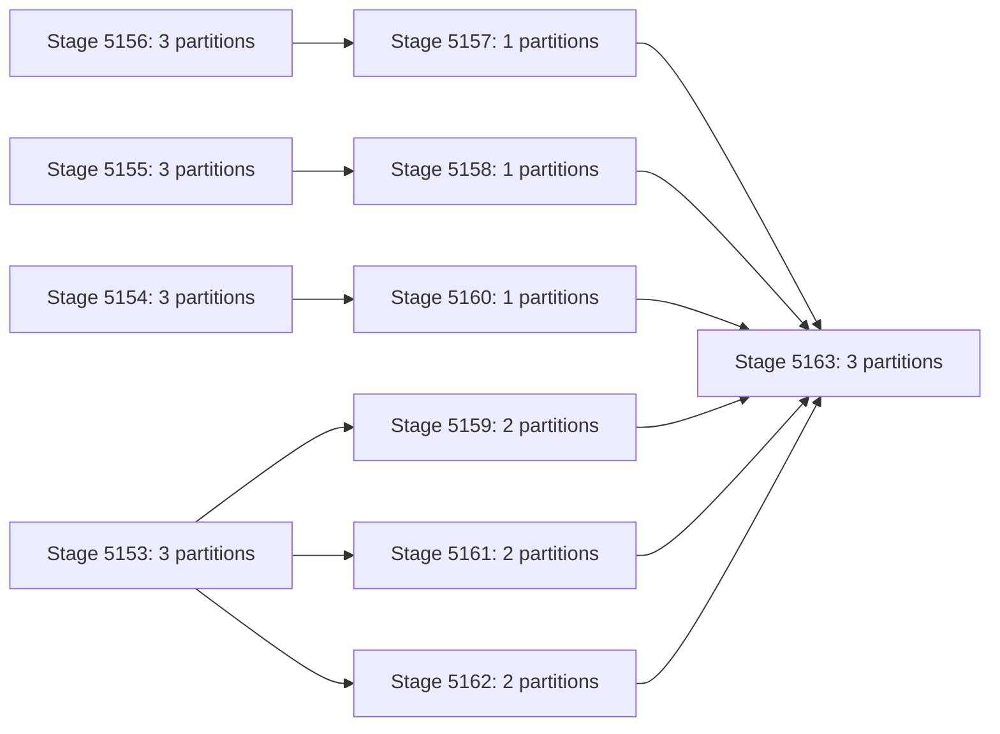

# Successful-run stage DAG

The complete DAG, stage names, parent IDs, partitions and per-stage task/shuffle totals are in [stage-dag.json](stage-dag.json). The graph has **5,667 stage IDs** and **4,532 parent edges**, including **3,663 referenced stages without task events**. All **2,004 executed stage-attempt totals** exactly match the retained original summary. Every name/partition count is present, no parent is missing, and the graph is acyclic.

The production summarizer omitted names and parent IDs; this evidence-only artifact supplements that gap from the retained successful raw log. No code or Spark run changed.

This diagram is a bounded actual ancestor subgraph of stage 5163 (11 nodes, 12 edges), not the entire graph. Full names and metrics remain in the JSON.

