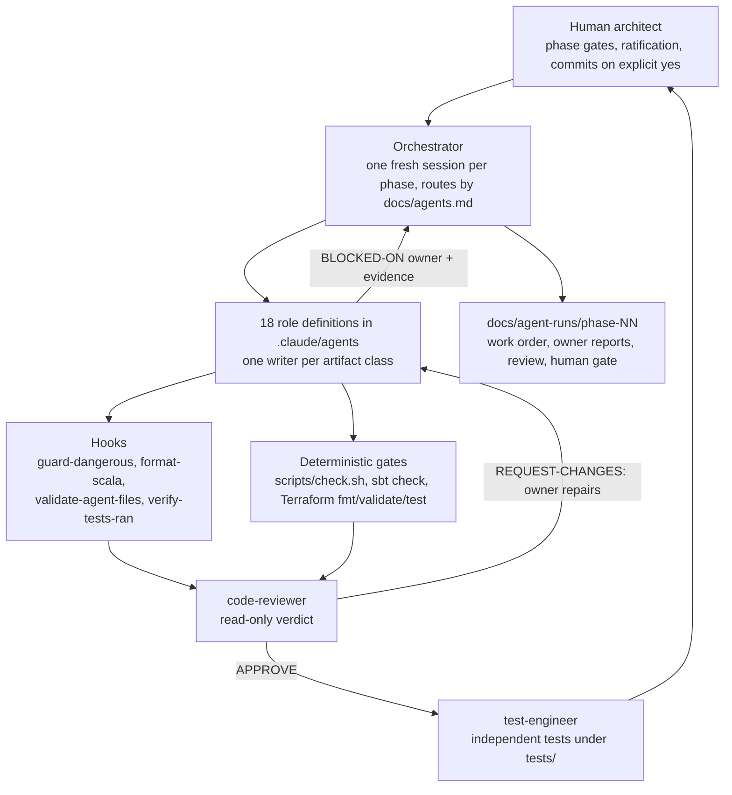
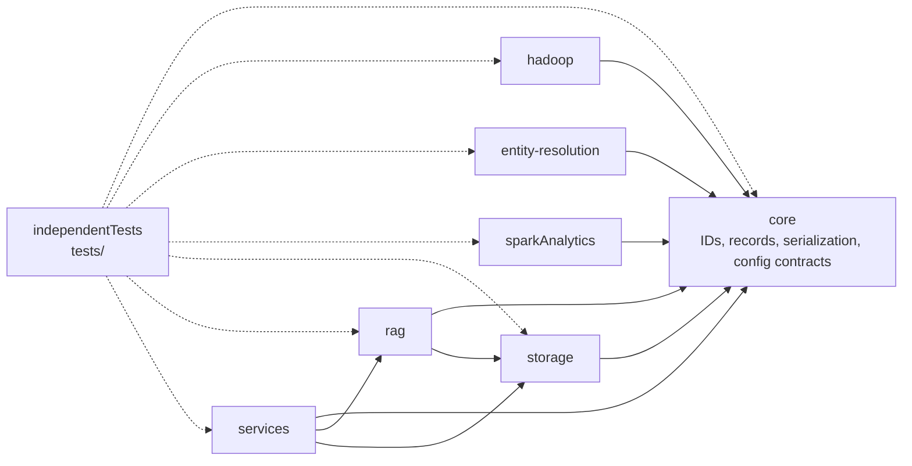
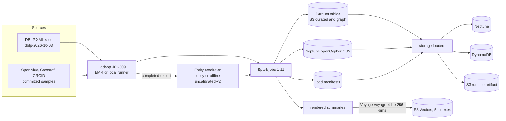
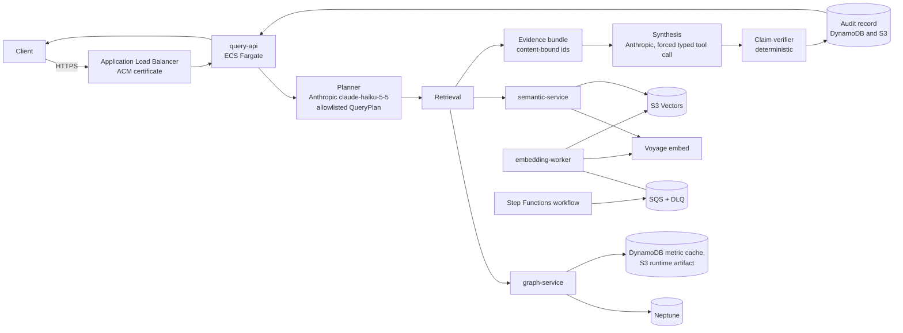

# ScholarChain architecture

ScholarChain is a Scala 3, Hadoop MapReduce, Spark, AWS and Graph-RAG system for questions about scholarly collaboration. This file has two views: the build-time view (the agentic factory that produced the code, its modules and its gates) and the runtime view (the data pipeline and the query path), followed by what was deployed on AWS and what was optional or not implemented. The factory ownership map itself is [docs/agents.md](agents.md); it is referenced here and not restated. The word "verified" below means a committed record shows it; each claim links to its record.

## 1. Build-time architecture

### 1.1 The agentic factory

- **Ownership.** Every artifact class has one writer: for example `domain-engineer` owns `modules/core`, `hadoop-engineer` owns `modules/hadoop`, `infra-engineer` owns `infra/terraform` and `scripts`, `documentation-engineer` owns `README.md` and `docs/**` outside the reserved subtrees. Out-of-scope work comes back as `BLOCKED-ON` with a path and the owning role. Reviewers report findings and never edit; no agent approves its own work ([docs/agents.md](agents.md), [AGENTS.md](../AGENTS.md)).
- **Definitions in the repository.** 18 role files in [.claude/agents/](../.claude/agents/), five commands in [.claude/commands/](../.claude/commands/) (`deploy`, `experiment`, `incident`, `rollback`, `run-pipeline`), four hook scripts in [.claude/hooks/](../.claude/hooks/), and [.claude/settings.json](../.claude/settings.json) with the permission deny list and hook wiring.
- **Hooks (Claude Code).** `guard-dangerous.sh` runs before Bash, Read, Write and Edit and blocks secret-file access, constitutional-file edits by any role other than the factory, `terraform apply` and `destroy`, force pushes, destructive AWS calls and destructive SQL. `format-scala.sh` and `validate-agent-files.sh` run after edits. `verify-tests-ran.sh` runs on Stop and checks the marker `.claude/.last-test-run`, which only a successful `sbt check` writes. The hooks apply when Claude Code is used; Codex and Cursor read `AGENTS.md` and rely on their own approvals plus the same human gates ([AGENTS.md](../AGENTS.md)).
- **Phase records.** Each phase has a folder `docs/agent-runs/phase-NN/` with the work order, owner reports, review rounds, repairs, test report and the human gate; 17 phases exist, 01 to 17 ([docs/agent-runs/](agent-runs/)). The Phase 16 count of review units, verdicts and findings over phases 01 to 15 is in [factory-metrics.md](../experiments/results/phase16/factory/factory-metrics.md): 65 APPROVE verdict lines, 62 REQUEST-CHANGES, 38 review units of which 8 were approved on first review. The same file says these are approximations of what was written down.
- **Provenance of decisions.** Human decisions are quoted in the phase records and are not rewritten by agents. Commits are made only on the human's explicit yes.

### 1.2 Modules

Edges are `dependsOn` in [build.sbt](../build.sbt). Dependencies flow toward `core`; no lower module depends on service routes or Terraform ([CLAUDE.md](../CLAUDE.md)). Spark reads the Hadoop and entity-resolution output files and depends only on `core`; it does not depend on either producer.

| Module | Responsibility | Guide |
|---|---|---|
| `core` | stable IDs, records, serialization, configuration and domain validation | [modules/core/README.md](../modules/core/README.md) |
| `hadoop` | nine MapReduce jobs: DBLP and JSON source preparation, exact identifiers, blocking, candidate pairs, teams, coauthor pairs, export | [modules/hadoop/README.md](../modules/hadoop/README.md) |
| `entity-resolution` | blocking features, scoring policy `er-offline-uncalibrated-v2`, accepted, rejected, unresolved and conflict decisions, review and evaluation tools | [modules/entity-resolution/README.md](../modules/entity-resolution/README.md) |
| `spark` (`sparkAnalytics`) | canonical identity, temporal coauthor graph, metrics, components, communities, bridges, k-core, paths, deltas, summaries, Parquet and Neptune CSV export | [modules/spark/README.md](../modules/spark/README.md) |
| `storage` | S3, Neptune, DynamoDB and S3 Vectors adapters; loaders; local export stores | [modules/storage/README.md](../modules/storage/README.md) |
| `rag` | planner, retrieval, evidence building, synthesis, claim verification, audit, provider clients | [modules/rag/README.md](../modules/rag/README.md) |
| `services` | typed HTTP API and runtime composition (four entry points) | [modules/services/README.md](../modules/services/README.md), [docs/api.md](api.md) |

Outside sbt: `infra/terraform` (Terraform 1.13.5, provider 6.44.0), `scripts/` (check, package, plan, deploy, rollback, cleanup, smoke, pipeline, experiment, archive), `datasets/`, `experiments/` and `load-tests/`, `prompts/` (runtime prompts and JSON schemas), and `tests/` (cross-module, contract, adversarial and Terraform tests).

### 1.3 Gates

| Gate | What it runs | Record |
|---|---|---|
| `scripts/check.sh` | seven gates in order: `constitution`, `hooks`, `shell`, `python`, `terraform`, `script-tests`, `sbt` | last full checks recorded for Phase 18: `RESULT: PASS gates=7` for packages 18A and 18B ([Phase 18 test report](agent-runs/phase-18/test-report.md)); the Day 3 runs (`20261126T170301Z-26256`: six gates PASS, terraform FAIL on formatting of two ignored local files; rerun `20261126T190048Z-32280` of the terraform gate PASS) are in the same report, section "Day 3" (see also [runbook](runbook.md), section 3). Earlier: the Phase 17 starting commit, `RESULT: PASS gates=7` ([phase-17 work order](agent-runs/phase-17/prompt.md)) |
| `sbt check` (alias of `checkTask`) | scalafmt checks, compiles the main and test sources, runs the tests of every module in order (core, hadoop, entityResolution, sparkAnalytics, storage, rag, services, independentTests), the contract test and the entity-resolution job-jar check, then `markTestRun` writes the Stop-hook marker ([build.sbt](../build.sbt), task `checkTask`) | [CLAUDE.md](../CLAUDE.md), Definition of done |
| Terraform | `fmt -check`, `validate` and `terraform test` with a mocked provider (no AWS call), from `infra/terraform` | [infra/terraform/README.md](../infra/terraform/README.md) |
| Review | an independent read-only `code-reviewer` verdict per work package | `docs/agent-runs/phase-NN/review.md` |
| Human gate | approval of plans, applies, deployments, scale, destruction, ratification and commits | `docs/agent-runs/phase-NN/human-gate.md` |

Package 17G ran the clean-checkout `sbt -batch clean check` on a fresh clone of `main` at `d1d4fe7` (JDK 17, offline, 2026-11-22): 1,773 tests succeeded, 0 failed, 2 canceled, sbt total time 14:48. The record of that replay, including the full `scripts/check.sh` result on the clone, is `docs/agent-runs/phase-17/17g-replay.md`.

## 2. Runtime architecture

### 2.1 Data pipeline

The stage contracts, job-by-job inputs, outputs and counters, and the run ids are in [docs/data-lineage.md](data-lineage.md). On AWS the Hadoop, entity-resolution and Spark steps run as six EMR steps on an existing cluster (stage-in, hadoop-prep, entity-resolution, spark-class-origin, spark-job, copy-out) with EFS staging ([scripts/README.md](../scripts/README.md), bounded pipeline). Locally, `scripts/lib/p6_local_chain.py` runs the same six steps with local stand-ins ([runbook](runbook.md), section 6). The `spark-job` step failed on EMR on 2026-11-18; in Phase 18 `scripts/emr/sc-step.sh` was changed so that the step fetches its template before it sets the Spark environment, and on 2026-11-25 all six steps completed on EMR in one run ([runbook](runbook.md), section 4.3).

### 2.2 Query path

- **query-api** accepts `POST /v1/query` with an idempotency key, runs the workflow in a bounded worker pool, and serves jobs, evidence and the explain projection. **graph-service** serves node, neighbor, metric, path and community reads from the loaded graph. **semantic-service** embeds the question and queries S3 Vectors. **embedding-worker** consumes embedding work from a queue with a dead-letter queue. All four are one distribution with four entry points ([modules/services/README.md](../modules/services/README.md)).
- **Model calls.** The planner and synthesis go to the Anthropic API; embeddings go to Voyage AI. Amazon Bedrock stays as a selectable fallback and was not run live, because the account's Bedrock quota was 0 ([docs/report/provider-fallback.md](report/provider-fallback.md), [service limits](service-limits.md)). Question text and evidence snippets leave AWS on the live path.
- **No model decides a fact.** The planner may only propose allowlisted operations; synthesis returns typed claims checked by the deterministic verifier against stored evidence; an audit record is readable before the answer is returned ([docs/data-lineage.md](data-lineage.md), section 7; [docs/threat-model.md](threat-model.md)).
- **Network.** One VPC with public, application and data subnets in two zones, one NAT gateway, S3 and DynamoDB gateway endpoints, service-to-service security-group rules ALB to query-api to graph and semantic, graph to Neptune. Public ingress is empty by default and was opened to the operator's address in Session 2 ([Terraform README](../infra/terraform/README.md); [decision log](agent-runs/phase-15/evidence/session-2/00-timeline/decision-log.md), runtime plan entry).

## 3. AWS components

Region `us-east-2`. The table separates what the Terraform tree authors, what the committed records show was created, and what was exercised. Source of the created set: the cleanup listing of the Session 2 stack (201 deletes by module: datalake 49, dynamodb 6, identity 25, messaging 5, neptune 5, network 58, observability 10, runtime 28, s3vectors 7, workflow 3, plus the ACM certificate and validation, two provider-key secret containers and a guard) in the [decision log](agent-runs/phase-15/evidence/session-2/00-timeline/decision-log.md), block 38.

| Component | Terraform module | Created in Session 1 and 2 | Exercised, with record |
|---|---|---|---|
| S3: seven versioned buckets (raw, curated, graph, rag, artifacts, logs, reports), KMS, public access blocked | `datalake` | yes | slice upload, runtime archive, EMR artifacts; [phase-14 gate](agent-runs/phase-14/human-gate.md), [decision log](agent-runs/phase-15/evidence/session-2/00-timeline/decision-log.md) |
| DynamoDB: six on-demand tables (RunLedger, EntityLinkCache, QuerySession, EvidenceBundle, ArtifactRegistry, ResearcherMetricCache) | `dynamodb` | yes | a RunLedger item shown as complete (clip REC12); reads and writes of the other tables are not shown separately in the evidence read: not verified |
| Neptune Serverless, 1 to 2.5 NCU | `neptune` | yes, both sessions | Session 1: graph loaded (`LOAD_COMPLETED`) and queried by the live runtime; Session 2: created and destroyed, graph load not shown in the evidence read |
| S3 Vectors: one bucket, five indexes, 256 dimensions, cosine | `s3vectors` | Session 1 and 2 | Session 2: 10,000 vectors, 5 of 5 query-smoke samples ([retrieval-metrics.md](../experiments/results/phase16/retrieval/retrieval-metrics.md)) |
| ECS Fargate cluster, four services, ECR (four immutable repositories), service discovery, CPU and request-count autoscaling | `runtime` | yes | Session 2: four services at 1 of 1; scale-out to 2 tasks seen during the load run; two stop-task recoveries ([evaluation](report/evaluation.md), group 5) |
| Application Load Balancer with an HTTPS listener and ACM certificate | `runtime` (+ ACM) | yes | healthz and readyz 200; 26,962 requests in the aborted load run |
| EMR on EC2 (`emr-7.8.0`, one primary and one core node) with EFS staging | `emr` | Session 1, 2 and Phase 18 | Session 2 (2026-11-18): Hadoop prep and entity resolution completed; the Spark step failed ([incident](incidents/2026-11-18-emr-spark-job-step-emrfilesystem.md), resolved in Phase 18). Phase 18 (2026-11-25): run 4 failed at `hadoop-prep` ([incident, root cause open](incidents/2026-11-25-emr-hadoop-prep-intermediate-missing.md)); run 5 completed all six steps, Spark included ([Phase 18 test report](agent-runs/phase-18/test-report.md)) |
| SQS work queue and dead-letter queue | `messaging` | yes | created; message flow not exercised in the evidence read |
| Step Functions embedding-dispatch workflow | `workflow` | yes (3 resources) | created; an execution is not shown in the evidence read: not verified |
| Secrets Manager (four secrets), KMS key | `identity`, `foundation` | yes | secrets created, read by ECS execution roles, then force-deleted; KMS key scheduled for deletion ([c5-secrets-delete.log](agent-runs/phase-15/evidence/session-2/section-c/c5-secrets-delete.log), [c7-kms.log](agent-runs/phase-15/evidence/session-2/section-c/c7-kms.log)) |
| CloudWatch dashboards, alarms, log groups | `observability` | yes | elasticity dashboard read by the human as a clip; no raw export was saved ([evaluation](report/evaluation.md), group 5) |
| AWS Budgets | account-level Terraform roots | yes | USD 25 limit with alerts at USD 18, 20 and 22 ([incident](incidents/2026-11-16-p0-budget-modify-backup-check.md)) |

The session stacks were destroyed by each session's cleanup (Session 1 by 2026-11-15, Session 2 on 2026-11-18); the budget and the billing role were kept, and the deployer role was removed on 2026-11-19. For the Phase 18 EMR proof the deployer role and a part of the stack were created again on 2026-11-25 and removed again the same evening (second destroy pass ended 2026-11-26 at 02:46Z; the human-confirmed final inventory shows nothing billable, with the KMS key pending deletion; [Phase 18 test report](agent-runs/phase-18/test-report.md), Day 2). Nothing is running ([cost-report.log](agent-runs/phase-15/evidence/session-2/c11/cost-report.log): no line still accruing after 2026-11-18 at the reading of 2026-11-20). The deployed runtime therefore cannot be queried today; the evidence is the committed records, the frozen Phase 16 results and the local query stack over the size S export (`LocalQueryStackMain`, used for the Q12 benchmark).

## 4. Optional, partial and not implemented

| Item | Status | Record |
|---|---|---|
| Amazon Bedrock as the live provider | implemented behind a switch, retained, never run live (quota 0) | [provider-fallback.md](report/provider-fallback.md) |
| OpenSearch adapter | not implemented (optional in the course map; omitted) | [modules/storage/README.md](../modules/storage/README.md), "Optional OpenSearch and extra indexes/services are omitted" |
| EMR Spark step | failed in Session 2 (2026-11-18); fixed in Phase 18 and completed once on EMR at size S on 2026-11-25 (one run, not repeated); size L was dropped from EMR and ran locally with an identity bypass | [incident](incidents/2026-11-18-emr-spark-job-step-emrfilesystem.md), [size-l-local-evidence.json](../experiments/inputs/15a/size-l-local-evidence.json) |
| Real-provider LLM adjudication in entity resolution | not run; the adjudicator is disabled in every evidence run | [identity-metrics.md](../experiments/results/phase16/identity/identity-metrics.md) |
| Sampled betweenness centrality | declined; bridge measures are partition-dependent participation measures | [modules/spark/README.md](../modules/spark/README.md), Job 7 |
| Vector-only and fused retrieval evaluation | no labelled run exists; only graph-only ranking was measured | [evaluation](report/evaluation.md), group 3 |
| Elasticity and AWS load evidence | one aborted run at 50 workers; no complete run on two tasks | [evaluation](report/evaluation.md), group 5, [incident](incidents/2026-11-18-rb-load-test-abort-5xx-burst.md) |
| Authentication beyond one shared API key; tenants | not implemented | [threat model](threat-model.md), section 7 |
| Remote Terraform state; multi-region or disaster recovery | not implemented; local state, one Region | [Terraform README](../infra/terraform/README.md), "State and cleanup design" |
| Public network ingress by default; WAF | not implemented | [threat model](threat-model.md), section 5 |
| Deterministic model output on the Anthropic route | not possible (no temperature control) | [provider-fallback.md](report/provider-fallback.md), section 6 |
| Fresh-clone build and command replay | observed in package 17G on 2026-11-22: `sbt -batch clean check` passed with 1,773 tests succeeded, 0 failed, 2 canceled; the full `scripts/check.sh` result is in `docs/agent-runs/phase-17/17g-replay.md` | [phase-17 work order](agent-runs/phase-17/prompt.md) |

## 5. Where to go next

| Question | File |
|---|---|
| How does a fact reach an answer? | [docs/data-lineage.md](data-lineage.md) |
| What are the HTTP routes and errors? | [docs/api.md](api.md) |
| What can go wrong and what defends it? | [docs/threat-model.md](threat-model.md) |
| Which limits and Region were used? | [docs/service-limits.md](service-limits.md) |
| How do I deploy, test, roll back and clean up? | [docs/runbook.md](runbook.md) |
| What were the measured results? | [docs/report/evaluation.md](report/evaluation.md) (Phase 16 record) and [docs/evaluation.md](evaluation.md) (Phase 17 version) |
