# ScholarChain data lineage

This file traces one fact from a source dataset to an answer: source dataset, Hadoop output, entity-resolution output, Spark output, stores, evidence ids, answer. Every count and run id below comes from a committed record that is linked next to it. Where a record is outside the repository (git-ignored `target/` files, private logs), the file says so and cites the committed excerpt or summary instead. No figure here was produced by a new run in package 17A-1.

## 1. The chain at a glance

```mermaid
flowchart LR
  SRC[Source datasets<br/>DBLP XML, OpenAlex, Crossref, ORCID] --> H[Hadoop prep J01-J09<br/>modules/hadoop]
  H -->|completed export + run-manifest| ER[Entity resolution<br/>modules/entity-resolution]
  H --> SP[Spark analytics, 11 jobs<br/>modules/spark]
  ER -->|accepted links, constraints| SP
  SP -->|Parquet, Neptune CSV, load manifests| ST[(Stores<br/>S3, Neptune, DynamoDB, S3 Vectors)]
  ST --> RT[Runtime retrieval<br/>modules/rag, modules/services]
  RT --> EV[Evidence items<br/>content-bound ids]
  EV --> V[Claim verifier + audit record]
  V --> ANS[Answer + claims + links]
```

Each arrow is a file contract with a completion marker; a downstream stage verifies the upstream marker, manifest and hashes before it reads. The binding rules are in [modules/hadoop/README.md](../modules/hadoop/README.md) (Output reuse), [modules/entity-resolution/README.md](../modules/entity-resolution/README.md) (Outputs and downstream ownership) and [modules/spark/README.md](../modules/spark/README.md) (Shared input, output, and execution rules).

## 2. Source datasets

| Source | Snapshot id used | Retrieval date | License | Record |
|---|---|---|---|---|
| DBLP XML | `dblp-2026-10-03` | 2026-10-05 for the committed sample; 2026-10-22 in the Phase 15 inputs file | CC0 1.0 (metadata) | [datasets/dataset-manifest.yaml](../datasets/dataset-manifest.yaml), [datasets/provenance/dblp-snapshot-2026-10-03-dagstuhl.txt](../datasets/provenance/dblp-snapshot-2026-10-03-dagstuhl.txt), [experiments/inputs/15a/datasets.json](../experiments/inputs/15a/datasets.json) |
| OpenAlex REST | `openalex-rest-2026-10-05` | 2026-10-05 | CC0 1.0 (OpenAlex data) | same manifest and [datasets/acquisition-index.v1.json](../datasets/acquisition-index.v1.json) |
| Crossref REST | `crossref-rest-2026-10-05` | 2026-10-05 | Crossref documentation CC BY 4.0; REST metadata largely free of copyright, some abstracts may be copyrighted | same |
| ORCID public API | `orcid-public-api-2026-10-05` | 2026-10-05 | public data file CC0 1.0; public API records subject to ORCID terms and record visibility | same |

The sizes used in the evidence are:

- **Size S (the bounded run).** A bounded slice of the DBLP snapshot: up to 2,500 `inproceedings` per venue from eight venues, years 2005 to 2026. The observed selection is 10,577 publications and 21,819 exact author strings; the largest author list has 71 entries and 63 records exceed 16 authors ([datasets/phase6/README.md](../datasets/phase6/README.md), manifest [dblp-slice-manifest.v1.json](../datasets/phase6/dblp-slice-manifest.v1.json)). The slice is a convenience slice with source-order and per-venue-cap bias, not a representative sample of DBLP. The other three sources are the committed Phase 4 samples ([datasets/samples/](../datasets/samples/), checksums in [SHA256SUMS](../datasets/samples/SHA256SUMS)), unscaled ([experiments/manifests/15a-emr-size-100.json](../experiments/manifests/15a-emr-size-100.json) description).
- **Size L (local only).** 48,187 publications ([datasets/phase15/dblp-l-slice-manifest.v1.json](../datasets/phase15/dblp-l-slice-manifest.v1.json), `lPublicationCount`). It was run locally through a Spark-only identity bypass, not on EMR ([size-l-local-evidence.json](../experiments/inputs/15a/size-l-local-evidence.json)); entity resolution was bypassed there, as that file discloses.

One full DBLP archive download is recorded: 1,107,081,001 bytes, MD5 `cbd329100ea1bbb2873fa2f6d414ea00` ([dblp-archive-acquisition.v1.json](../datasets/phase6/dblp-archive-acquisition.v1.json)). The archive and the selected XML stay in git-ignored `target/`; the repository holds the manifests and checksums.

## 3. Hadoop preparation, jobs J01 to J09

Source: `modules/hadoop/src/main/scala/edu/uic/cs441/scholarchain/hadoop/` (`PrepJobs.scala`, `HadoopPrepPipeline.scala`, `PrepSupport.scala`, `DblpInput.scala`, `DerivedRecords.scala`) and [modules/hadoop/README.md](../modules/hadoop/README.md). The driver `HadoopPrepPipeline.execute` runs the nine jobs in order J01 to J09, sums the counters, writes `run-manifest.json` and `counter-summary.json`, and writes the completion marker `_SCHOLARCHAIN_COMPLETE` only after every job succeeded and the export has partitions. The job graph is J01 and J02 into J03 into J04; J04 feeds J05 (then J06), J07, J08 and J09.

### Settings shared by all jobs

| Item | Value | Source |
|---|---|---|
| Partitioner | Hadoop default `HashPartitioner` for every job | no partitioner class set in the module (searched); README "Job graph" |
| Combiner | none in any job: block size, observation identity and pair expansion are not safe partial aggregates | README "Job graph" |
| Reducers | `reducerCount` from the config, applied to every job; 1 in the committed sample config and in the Phase 15 EMR config | [scholarchain.hadoop-prep.v1.json](../modules/core/src/main/resources/scholarchain.hadoop-prep.v1.json), [prep-config.json](../experiments/inputs/15a/prep-config.json) |
| Compression | `compressionCodec` `none`, `intermediateCompressionEnabled` false in both configs; when enabled, J01 to J08 write compressed part files with the configured codec and J09 stays uncompressed; shuffle compression is off | `PrepJobs.configuration`, `compressIntermediate` |
| Limits | `maxRecordBytes` 1,048,576; `maxXmlEntityExpansion` 1,048,576; `maxCandidateBlockSize` 32; `maxCandidatePairsPerBlock` 128; `maxAuthorTeamSize` 16; `maxLocalSampleRecords` 100 (sample) and 60,000 (Phase 15) | same configs |
| Intermediate line cap | J03 to J09 read domain JSON larger than the source record: at least 1 MiB, at most 16 MiB and not below `maxRecordBytes` | `IntermediateBytes`, `useIntermediateCap` |
| Counters (group `SCHOLARCHAIN`) | `INPUT`, `ACCEPTED`, `REJECTED`, `DUPLICATE`, `CONFLICT`, `OVERSIZE_BLOCK`, `OVERSIZE_TEAM`, `OVERSIZE_TEAM_PAIR_STEP`, `EMITTED_PAIR`, `MISSING_KEY`, `SCHEMA_FAILURE`; `counter-summary.json` holds their sums over the nine jobs; `OVERSIZE_TEAM_PAIR_STEP` was added on 2026-11-26 (J08, see below), so the Phase 15 counter line in the Observed counters section has no such counter | `PrepCounters` (`PrepSupport.scala`, lines 22 to 23 and 35 to 36) |
| Output location in a run | `<outputRoot>/<run uuid>/intermediate/j01 ... j08`, `<outputRoot>/<run uuid>/export/snapshot=<snapshot>/run=<uuid>/<kind>/part-*`, `stats/`, `run-manifest.json`, `counter-summary.json`, `_SCHOLARCHAIN_COMPLETE` | `HadoopPrepPipeline.runJobs` |
| S3 prefixes (Phase 15 EMR run) | input `emr/<run prefix>/input/size-100`, output `pipeline/<run prefix>/15a/size-100` in the artifacts bucket (bucket name not recorded here); the Hadoop step wrote to a plain absolute path on the EFS mount and a copy-out step was to move results to the output prefix, but that step never ran | [15a-emr-size-100.json](../experiments/manifests/15a-emr-size-100.json), `scripts/emr/sc-step.sh`, decision log line for block 36 ("EMR copy-out never ran") in [decision-log.md](agent-runs/phase-15/evidence/session-2/00-timeline/decision-log.md) |
| Idempotency | the driver never deletes an output directory; reuse needs the completion marker, `run-manifest.json` and every export partition named by the marker, each bound by relative path, byte length and SHA-256; run id, snapshots, retrieval dates, input checksums, schema and transformation versions and the config fingerprint must match; a changed snapshot does not reuse old results | README "Output reuse"; test "failed run leaves no completion marker and a matching marker can be reused" |
| Transformation version | `hadoop-prep-j01-j09-v3-stable-overflow-lineage`. This one label covers the output both before and after the J08 change of 2026-11-26 (one `OversizeTeam` reject of stage `CoauthorPair` and the counter `OVERSIZE_TEAM_PAIR_STEP` per skipped oversize team): by human decision of 2026-11-26 ("Keep v3, document") the label was not bumped. Output reuse is keyed by run id, so a fresh run id never reuses output written by the older code | `PrepLimits.TransformationVersion` |

### Per-job contracts

"Key" and "value" are the Hadoop `Text` key and value. Records travel as lines `<kind-and-lineage prefix> JSON`; the lineage prefix is private to the module and removed by the next job.

| Job | Input format, key, value | Mapper output (key, value) | Reducer: input and output | Reject conditions (reason code) | Fixture |
|---|---|---|---|---|---|
| J01 `DblpExtractJob` (`DblpExtractMapper`) | `DblpXmlInputFormat`: one complete top-level DBLP element per record, splittable unless compressed; key is the byte offset (`LongWritable`); value is a JSON header line (entities, flags) then the record XML | domain `WorkRecord` and related records keyed by record kind with an observation-instance suffix; value is domain JSON | `PassReducer` writes every value unchanged | unterminated or malformed closing tag (`MalformedRecord`); oversize record (`OversizeRecord`); unsafe entity (`UnsafeEntity`); missing title, unsupported element, malformed identifier; sample cap past `maxLocalSampleRecords` (`OversizeRecord`, detail `maxLocalSampleRecords`) | `datasets/samples/dblp/linked-records.xml`; tests in `DblpXmlRegressionSpec`, `HadoopPrepSpec` ("split edges and gzip keep complete records", "a FileSplit inside a comment or CDATA does not invent a publication") |
| J02 `SourceNormalizeJob` (`OpenAlexMapper`, `CrossrefMapper`, `OrcidMapper` through `MultipleInputs`) | `BoundedLineInputFormat`: one JSON line; key is the file offset; value is the line (a line over `maxRecordBytes` becomes an oversize marker without being kept as a String) | normalized source records (works, ORCID profile and activity, institutions, venues, enrichment links) keyed by record kind plus instance | `PassReducer` | malformed JSON; invalid identifier (DOI, ORCID, venue, topic); oversize line; sample cap | `datasets/samples/{openalex,crossref,orcid}/*`; `SourceEvidenceRegressionSpec`, `HadoopPrepSpec` ("a malformed DOI is an invalid-identifier reject") |
| J03 `ExactIdentifierIndexJob` (`IndexMapper`) | `BoundedLineInputFormat` over J01 and J02 output | one index row per exact key (DOI, arXiv, ORCID, OpenAlex id and others) keyed by record kind; value `IndexRow` JSON with a payload hash; `MISSING_KEY` counted when a work has no exact key | `PassReducer` | an index row that fails `DomainValidation` (`InvalidIdentifier`) | J01 and J02 output of the sample |
| J04 `ExactIdentifierJoinJob` (`JoinMapper`) | `BoundedLineInputFormat` over J01, J02, J03 output | key `source`, source record id, snapshot; value is a tagged `idx` or `rec` line | `JoinReducer`: all lines of one observation group; compares complete observations. Identical copies keep one survivor and emit its records, index rows and a derived `Bibliography` row; a differing payload for the same source, record and snapshot drops both sides | `DuplicateIdenticalObservation`, `ConflictingObservation`, group over the observation limit (`OversizeRecord`) | `HadoopPrepSpec` ("duplicate, conflict, shared DOI, ORCID activity, teams, and text refs", "identical payloads survive once and conflicting payloads are not exported") |
| J05 `BlockingKeyJob` (`BlockMapper`) | `BoundedLineInputFormat` over J04 `Bibliography` rows | one key per blocking key of the row: `exact:`, `name:`, `initial:`, `title-year:`, `venue:`, `affiliation:`, `coauthor:`, or `fallback:` (source plus record id) when nothing else exists; value `BlockMember` JSON; `MISSING_KEY` when only fallback keys exist | `BlockReducer`: the members of one block; keeps distinct members up to `maxCandidateBlockSize` and checks the pair count | block over `maxCandidateBlockSize` (`OversizeBlock`, whole block rejected), pairs over `maxCandidatePairsPerBlock` (`OversizeCandidatePairs`); the reducer writes `largestBlock` stats | `HadoopPrepSpec` ("block and team limits reject the whole group"), `AdversarialBlockingReplaySpec` in `tests/` |
| J06 `CandidateJoinJob` (`CandidateMapper`) | `BoundedLineInputFormat` over J05 members | key = block key; value `BlockMember` JSON | `CandidateReducer`: emits `MatchCandidate` for each pair in a block, sorted by the candidate observation order key; a `fallback:` block emits nothing | same oversize codes; candidate that fails validation (`SchemaFailure`); `MISSING_KEY` when a pair cannot be built | `HadoopPrepSpec` ("bibliographic candidates do not require a shared DOI") |
| J07 `PublicationTeamJob` (`TeamMapper`) | `BoundedLineInputFormat` over J04 works | team and authorship records keyed by kind; the mapper records `largestTeam` | `PassReducer` | team over `maxAuthorTeamSize` (`OversizeTeam`, emitted by the mapper) | `HadoopPrepSpec` ("block and team limits reject the whole group") |
| J08 `CoauthorPairExpansionJob` (`PairMapper`) | `BoundedLineInputFormat` over J04 works | unordered coauthor pair records with work and year provenance; the mapper records `largestPairExpansion` (pair count of the team, `n(n-1)/2`, overflow-safe) | `PassReducer` | team over `maxAuthorTeamSize`: no pairs and one reject of its own (`OversizeTeam`, stage `CoauthorPair`, excerpt "pair step skipped work <workId>: team N exceeds M"; counted as `OVERSIZE_TEAM_PAIR_STEP`), so the work is not skipped silently even though J07 also rejects the same team; pair expansion over `maxCandidatePairsPerBlock` (`OversizeCandidatePairs`, one reject for the work) | `HadoopPrepSpec` ("pair arithmetic is overflow-safe...", "block and team limits reject the whole group", "largestPairExpansion counts coauthor teams and not block pairs"); `CoauthorPairGenerationSpec` ("a team one above the team-size limit yields no pairs and one pair-step reject") |
| J09 `GraphCandidateExportJob` (`ExportMapper`, `ExportReducer`) | `BoundedLineInputFormat` over J04 to J08 output | key `out` plus snapshot for record lines, key `ref` plus text id for abstract references (`need` and `have` flags) | `ExportReducer` writes through `MultipleOutputs` to `snapshot=<s>/run=<uuid>/<kind>/part`; it also derives `AuthorMention` rows and graph edges from works and topic edges from enrichment links, each validated by `DomainValidation` | graph edge failing validation (`SchemaFailure`); `abstractTextRef` with no emitted text document (`SchemaFailure`) | `HadoopPrepSpec` ("missing abstract document exports its reject in the public reject partition", "a graph edge that fails validation is a schema-failure reject") |

### Per-job execution detail, outputs and test fixtures

Every job below uses no combiner and the default Hadoop `HashPartitioner` (no custom partitioner, sort comparator or grouping comparator is set anywhere in the module), and takes its reducer count from `mapreduce.job.reduces` (`PrepJobs.scala` lines 42, 103, 158, 240 and 275). Output paths are relative to the run directory `<outputRoot>/<run uuid>/` laid out by `HadoopPrepPipeline.scala` (lines 164 to 181: `intermediate/j01` to `j08`, `stats/`, `export/`; job wiring at lines 183 to 197). The module uses no AWS SDK. It reads and writes through the Hadoop FileSystem API, which accepts `s3://`, `s3a://` and `s3n://` output roots: they stay `org.apache.hadoop.fs.Path` values and are not created as local directories (`modules/hadoop/README.md`, line 76; tests `HadoopPrepReviewSpec.scala` lines 200, 210 and 237 and `HadoopPrepSpec.scala` line 742), and inputs go through `FsPaths.file`. The config path must be local: `HadoopPrepMain.scala` (lines 31 to 39) refuses one that starts with `s3://`, `s3a://`, `s3n://` or `hdfs://`. In the Phase 15 EMR run the step script `scripts/emr/sc-step.sh` moved the data: its stage-in step reads the step key `INPUT_PREFIX` (lines 64 and 246 to 251, with a byte ceiling) and its copy-out step writes to `OUTPUT_PREFIX` (lines 69 and 424 to 427). `localize` (line 157) uses `hadoop fs -copyToLocal` for any source given as an S3 or HDFS URI and checks its SHA-256; it fetches the Hadoop jars and config, the entity-resolution jar, policy and config, and the Spark template (`sc-step.sh`, lines 275 to 346). In that run the copy-out step never ran (see the S3 prefixes row above).

Compression of the job output is off by default (`compressionCodec` `none`, `intermediateCompressionEnabled` false in `scholarchain.hadoop-prep.v1.json`, lines 11 and 12). When it is enabled, `compressIntermediate` (`PrepJobs.scala`, lines 73 to 82) compresses the J01 to J08 outputs; J09 never is (`setCompressOutput(job, false)`, line 245, and the guard at line 278). Map-output (shuffle) compression is always off (`PrepJobs.scala`, lines 55 to 58). The test "intermediate compression still feeds the next job" (`HadoopPrepReviewSpec.scala`, line 429) covers the compressed path.

Counters: a reject written through `TaskSink.emit` adds to `REJECTED`. The reasons `DuplicateIdenticalObservation`, `ConflictingObservation`, `OversizeBlock`, `OversizeTeam` and `SchemaFailure` also add to `DUPLICATE`, `CONFLICT`, `OVERSIZE_BLOCK`, a team counter and `SCHEMA_FAILURE`. The team counter depends on the reject's stage: an `OversizeTeam` reject of stage `CoauthorPair` (J08) adds to `OVERSIZE_TEAM_PAIR_STEP`, any other (J07) adds to `OVERSIZE_TEAM`, so one oversize team is counted once under each name and the two are not summed into one. Every other reason, including `OversizeCandidatePairs` and `OversizeRecord`, appears only in `REJECTED` (`PrepSupport.scala`, lines 568 to 600; the stage split is at lines 584 to 589). Two J09 paths write rejects without any counter: graph-edge `SchemaFailure` rejects in `ExportReducer.writeCheckedGraph` and oversize-line (`OversizeRecord`) rejects written by `ExportMapper` with `context.write` (`PrepJobs.scala`, lines 1066 to 1078 and 1145 to 1165); these reach the export `reject` partition but are in neither `REJECTED` nor `SCHEMA_FAILURE`. `counter-summary.json` sums the counters over all nine jobs. J06 repeats J05's block check as a guard: J05 emits members only for blocks within both limits, so under one config the repeated check does not fire on J05 output.

| Job | Input and key/value | Reducer | Output location | Output compression | Rejects and counters | Test fixtures (`modules/hadoop/src/test/scala/edu/uic/cs441/scholarchain/hadoop/`) |
|---|---|---|---|---|---|---|
| J01 | DBLP XML (`DblpXmlInputFormat`); offset key, record XML value; mapper output keyed by record kind | `PassReducer` | `intermediate/j01` | config; default none | `MalformedRecord`, `OversizeRecord`, `UnsafeEntity`; `REJECTED`, `ACCEPTED`, `INPUT` | `HadoopPrepSpec.scala` lines 43, 200, 234 and 272; `DblpXmlRegressionSpec.scala`; `HadoopPrepReviewSpec.scala` line 429 |
| J02 | OpenAlex, Crossref and ORCID JSON lines (`BoundedLineInputFormat`, `MultipleInputs`); offset key, line value | `PassReducer` | `intermediate/j02` | config; default none | malformed JSON, invalid identifier, oversize line; `REJECTED` | `SourceEvidenceRegressionSpec.scala`; `HadoopPrepReviewSpec.scala` line 123 |
| J03 | J01 and J02 output; key is the record kind, value an index row | `PassReducer` | `intermediate/j03` | config; default none | `InvalidIdentifier`; `REJECTED`, `MISSING_KEY` | `HadoopPrepSpec.scala` line 307 |
| J04 | J01, J02, J03 output; key is source, record id and snapshot, value a tagged `idx` or `rec` line | `JoinReducer` | `intermediate/j04` | config; default none | `DuplicateIdenticalObservation`, `ConflictingObservation`, `OversizeRecord`; `DUPLICATE`, `CONFLICT`, `REJECTED` | `HadoopPrepSpec.scala` lines 307, 613 and 726 |
| J05 | J04 bibliography rows; key is a blocking key, value a `BlockMember` | `BlockReducer` | `intermediate/j05`; `stats/` (`largestBlock`) | config; default none | `OversizeBlock` (`OVERSIZE_BLOCK`), `OversizeCandidatePairs` (`REJECTED` only); `MISSING_KEY` | `HadoopPrepSpec.scala` lines 411 and 463 to 495; `AdversarialBlockingReplaySpec` in `tests/` |
| J06 | J05 members; key is the block key | `CandidateReducer` | `intermediate/j06` | config; default none | same oversize codes as J05, `SchemaFailure`; `OVERSIZE_BLOCK`, `SCHEMA_FAILURE`, `EMITTED_PAIR`, `MISSING_KEY` | `HadoopPrepSpec.scala` lines 411 and 463 to 495 |
| J07 | J04 works; team and authorship records keyed by kind | `PassReducer` | `intermediate/j07`; `stats/` (`largestTeam`) | config; default none | `OversizeTeam` (`OVERSIZE_TEAM`) | `HadoopPrepSpec.scala` lines 411, 449 to 451 and 454 (team counter) and 560 (provenance gate) |
| J08 | J04 works; coauthor pair records with work and year provenance | `PassReducer` | `intermediate/j08`; `stats/` (`largestPairExpansion`) | config; default none | `OversizeTeam` (stage `CoauthorPair`; `OVERSIZE_TEAM_PAIR_STEP`), `OversizeCandidatePairs` (`REJECTED` only); `EMITTED_PAIR` | `HadoopPrepSpec.scala` lines 411, 452 to 462 (pair-step reject and counter), 560 (provenance gate) and 664; `CoauthorPairGenerationSpec.scala` (lines 213 to 258 for the pair-step reject and counters) |
| J09 | J04 to J08 output; key `out` plus snapshot, or `ref` plus text id | `ExportReducer` (`MultipleOutputs`) | `export/snapshot=<snapshot>/run=<uuid>/<kind>/part-*` | never compressed | `OversizeRecord` (oversize line, no counter); `SchemaFailure` (graph-edge schema failures are not counted in `SCHEMA_FAILURE`) | `HadoopPrepReviewSpec.scala` line 568; `HadoopPrepSpec.scala` lines 560 (text-ref check `TextRefs`, the post-export helper; J09 itself uses the `need`/`have` flags, `PrepJobs.scala:1180-1203`), 704 and 716 |

The whole pipeline, including the completion marker and output reuse, is exercised by `HadoopPrepSpec.scala` line 498 ("failed run leaves no completion marker and a matching marker can be reused"). `CoauthorPairGenerationSpec.scala` covers the J08 pair generation and its limits at the function level (`DerivedRecords.pairs` and `DerivedRecords.teams`), including the pair-step reject and its counter (lines 213 to 258).

### Known limitations and trade-offs (Hadoop)

These are choices the module makes today, stated so that nobody reads more into the job graph than it does.

- **No combiner, custom partitioner or shuffle compression.** All nine jobs use the default hash partitioner and no combiner. The module README gives the reason for the missing combiner: block size, observation identity and pair expansion are not safe partial aggregates. No reason for keeping the default partitioner is recorded in the repository. The committed sample config and the Phase 15 EMR config both set `reducerCount` to 1, so in those runs every key reaches the same single reducer and partitioning cannot skew work between reducers. Compression of job output is off by default and shuffle compression is always off; the compressed path is tested, not run at scale.
- **Oversize blocks (J05, J06).** The limits are applied in the reducers: `BlockReducer` (`PrepJobs.scala`, line 783) keeps at most `maxCandidateBlockSize` (32) distinct members and rejects the whole block as `OversizeBlock` (lines 827 to 834), or as `OversizeCandidatePairs` when the pair count exceeds `maxCandidatePairsPerBlock` (128; lines 835 to 843); `CandidateReducer` (lines 882 to 933) repeats the check. There is no pre-pass and no salting, so all values of an oversize key still reach one reducer. That reducer streams the values and stops keeping members at the cap, so its memory is bounded by the cap and not by the block size, but its running time still grows with the number of values of the key. A rejected block yields no candidate pairs from that key, so pairs that only that key would have produced are not produced; each rejection is recorded with the key and counted. No reason for choosing a reducer-side cap over a pre-pass or salting is recorded in the repository. The bounded course scale is what the recorded runs used: the Phase 15 size-100 run reported `OVERSIZE_BLOCK 517` ([hadoop-prep-counters.txt](agent-runs/phase-15/evidence/session-2/emr/hadoop-prep-counters.txt)) with one reducer.
- **Oversize teams (J07, J08).** J07 rejects a team larger than `maxAuthorTeamSize` (16) with `OversizeTeam` ("team N exceeds M", `DerivedRecords.scala`, lines 13 to 27) and counts `OVERSIZE_TEAM` (`PrepSupport.scala`, lines 22 and 584 to 589). J08 (`DerivedRecords.pairs`, lines 65 to 80) returns no pairs for such a team and, since 2026-11-26, emits one reject of its own: reason `OversizeTeam` (the J07 code), stage `CoauthorPair`, excerpt "pair step skipped work <workId>: team N exceeds M". `TaskSink.emit` counts it as `OVERSIZE_TEAM_PAIR_STEP` (`PrepSupport.scala`, lines 23, 36 and 584 to 589) and, like every reject, in `REJECTED`; J07 keeps `OVERSIZE_TEAM`. Before that change J08 skipped the team silently and raised no second reject, so a run after the change has one more reject per oversize team than the same input before it. Pairs for teams within the limit are unchanged. J08 has its own second limit: an expansion above `maxCandidatePairsPerBlock` is rejected as `OversizeCandidatePairs` (`DerivedRecords.scala`, lines 82 to 98), which is counted only in `REJECTED`, not in a dedicated counter. With the committed limits (16 and 128) a team that passes the team limit has at most 16 x 15 / 2 = 120 pairs, so J08's pair limit cannot be reached by such a team in those configurations; it matters only if the two limits are changed separately. The 63 `OVERSIZE_TEAM` rejects of the Phase 15 run agree with the dataset note on records with more than 16 authors (see Observed counters below). A team over the limit contributes no coauthor pairs.

Notes on the mapping to the course's recommended job names. The course lists J03 and J04 as an identifier index and an exact-identifier join. This implementation indexes exact keys in J03 and uses J04 to decide duplicate versus conflicting observations of one source record and to build the bibliography rows that J05 blocks; the exact identifier keys themselves travel in the index rows and the `exact:` blocking keys, so an exact-ID candidate pair arises in J06. The module README states the same behavior.

Export kinds written by J09: `work`, `author-mention`, `institution`, `mention-affiliation`, `venue`, `enrichment`, `text`, `orcid-profile`, `orcid-activity`, `index`, `match-candidate`, `graph-edge`, `reject` (README). Rejects are never dropped silently: each carries the source, locator, snapshot, run id, stage and reason code (`Rejects.record`).

### Observed counters

The Phase 15 EMR run (run `15a-emr-size-100-20261118T163203Z-87466`) printed this line for the Hadoop step ([hadoop-prep-counters.txt](agent-runs/phase-15/evidence/session-2/emr/hadoop-prep-counters.txt), from the downloaded step log):

`INPUT 290343, ACCEPTED 515309, REJECTED 1243, DUPLICATE 0, CONFLICT 0, OVERSIZE_BLOCK 517, OVERSIZE_TEAM 63, EMITTED_PAIR 243321, MISSING_KEY 0, SCHEMA_FAILURE 21`

This is a historical observation of 2026-11-18. The Hadoop source changed on 2026-11-26: J08 now reports its own skipped oversize teams as `OVERSIZE_TEAM_PAIR_STEP` and as extra `REJECTED` rejects (see Oversize teams above). No run after that change has been made or recorded here, so the line above carries no `OVERSIZE_TEAM_PAIR_STEP` field; a run after the change reports that counter and a higher `REJECTED` than this line for the same input. The numbers above are not restated for the new code.

The Phase 16 performance file states that the Hadoop counters were identical on EMR and on the local run of the same input ([performance-metrics.md](../experiments/results/phase16/performance/performance-metrics.md), line "Hadoop counters identical on EMR and local: True"). The 63 `OVERSIZE_TEAM` rejects agree with the dataset note that 63 records have more than 16 authors ([datasets/phase6/README.md](../datasets/phase6/README.md)). The largest block and team are reported by the `stats/` files of the run, which are in git-ignored `target/` and not read here.

## 4. Entity resolution

Source: `modules/entity-resolution/` and its [README](../modules/entity-resolution/README.md). Input: a completed Hadoop export (the reader verifies the marker and hashes first). The policy used in every evidence run is `er-offline-uncalibrated-v2` with feature policy `er-features-v2`; the LLM adjudicator is disabled (deterministic fake provider, spend limit 0.0), so no model call is part of identity decisions ([config-sources.json](../experiments/inputs/15a/config-sources.json), [identity-metrics.md](../experiments/results/phase16/identity/identity-metrics.md)).

Output per entity type (researcher, work): separate accepted, rejected, unresolved and conflict JSONL streams, accepted pairwise links, one complete grouping-constraint bundle, evidence and decision details, `resolution-manifest.json` binding run, input, policy and every file's length, hash and count, and a completion marker over the manifest. The ER stage assigns no canonical groups; Spark does. Identity evaluation (precision 100.0%, recall 79.2% on 194 held-out binary pairs, with the limits stated there) is in [identity-metrics.md](../experiments/results/phase16/identity/identity-metrics.md) and summarized in [docs/report/evaluation.md](report/evaluation.md), group 1.

## 5. Spark analytics

Source: `modules/spark/` and its [README](../modules/spark/README.md). One run reads one completed Hadoop export and one completed entity-resolution export; their manifests, policy hashes, run ids and snapshots must agree with the Spark config before anything is written. Eleven jobs run in `Phase6Main`:

| Job | Output tables (relative to the export root) |
|---|---|
| 1 canonical researchers, works, authorship | `nodes/type={researcher,author_mention,work,venue,institution,topic}`, edges `authored`, `resolves_to`, `published_in`, `affiliated_with`, `has_topic`, `integrity/` |
| 2 temporal weighted coauthor graph | `edges/type=coauthored_with`, `edges/type=coauthored_with_support` (every supporting work) |
| 3 breadth and team statistics | `metrics/type=researcher_collaboration/window=...` |
| 4 connected components | `metrics/type=components`, `component_summaries` |
| 5 selected paths and distance estimate | `path-evidence/window=...`, `metrics/type=path_length_estimate` |
| 6 communities (weighted label propagation) | `metrics/type=communities`, `cross_community_edges` |
| 7 bridge measures | `metrics/type=bridges` |
| 8 k-core | coreness in the researcher metrics, view `metrics/type=kcore` |
| 9 temporal comparisons | `metrics/type=temporal_changes` |
| 10 deterministic semantic summaries | `semantic-summaries/window=...` |
| 11 Parquet export, manifests, gate | `run-manifest.json`, `run-metadata.json`, `counters.json`, `plans/`, `event-log-summary.json`, `load-manifests/{neptune,dynamodb,s3vectors,s3}.json`, completion marker `_SCHOLARCHAIN_SPARK_COMPLETE`, and the Neptune CSV handoff `neptune-opencypher-csv/` |

Windows: `all-years`, `through-2009`, `2010-2014`, `2015-2019`, `2020-2026`, `since-2015`. Every table carries `runId` and a `schemaVersion`; the logical run id is a deterministic hash of the two input manifest bindings, the config fingerprint, the policy versions and the code version; a different code build gives a different run id. Content hashes are order-independent Merkle hashes over sorted rows, not hashes of Parquet bytes.

### Run `run:ba7402d1-959a-4277-8c6e-e92878a38afa` (size S export)

This is the export the stores, the Q12 answer key and the graph audit use. It is a local run of the Hadoop, entity-resolution and Spark chain on the size S slice (the "P6 chain"); the Session 2 EMR chain (2026-11-18) on the same slice failed at the Spark step, and the human chose this local export as the fallback (the Phase 18 EMR run of 2026-11-25 is described in the next subsection) ([human-gate.md](agent-runs/phase-15/human-gate.md), EMR pipeline paragraph). The export's file listing and checks:

- 60 files read, file-listing sha256 `e277df62...c910e` (full value in [graph-correctness.md](../experiments/results/phase16/graph/graph-correctness.md)); `SHA256SUMS` of the export checked with 0 failures on 2026-11-18 ([decision log](agent-runs/phase-15/evidence/session-2/00-timeline/decision-log.md), block 22).
- 78,104 node rows (AUTHOR_MENTION 45,591; INSTITUTION 1; RESEARCHER 21,819; TOPIC 3; VENUE 112; WORK 10,578), 100,252 graph-edge rows, 228,715 coauthor-edge rows ([graph-correctness.md](../experiments/results/phase16/graph/graph-correctness.md)).
- Integrity: 0 of 100,252 graph edges and 0 of 228,715 coauthor edges with an unresolved endpoint; every coauthor edge fully supported by works both endpoints authored; 4 unresolved mentions; `missingGraphEndpoints` 0, `pairCountMismatches` 0 (same file). These checks show internal consistency, not that identity decisions are right.
- The code and its tests: 6 Spark suites with 47 tests were listed (not run) in that evaluation; the last recorded full check is quoted there.

### Run `run:30b3ef84-11dc-4c8c-b9c2-c632477d7282` (size S, EMR, Phase 18, 2026-11-25)

This is the Spark export of the EMR retry (run `15a-emr-size-100-20261125T174034Z-99560`, 17:40:34Z to 18:14:39Z) after the Phase 18 fix to `scripts/emr/sc-step.sh`. All six steps completed and the export carries the `_SCHOLARCHAIN_SPARK_COMPLETE` marker ([Phase 18 test report](agent-runs/phase-18/test-report.md), Day 2). Its lineage in the counters file: Hadoop run `run:1c9222da-8c90-4e2a-96a4-aff08ca46318` (snapshot `crossref-rest-2026-10-05,dblp-2026-10-03,openalex-rest-2026-10-05,orcid-public-api-2026-10-05`), entity-resolution run `run:08c55f9a-b026-4555-8402-4e5c1c8dd64e`, policy `er-offline-uncalibrated-v2` ([spark-counters.json](agent-runs/phase-18/evidence/day2/emr/spark-counters.json), `context.lineage`).

- Counters: canonicalWorks 10,578, canonicalResearchers 21,819, allYearsEdges 81,181, components 3,942, crossCommunityEdges 17,589, communityIterations 20 with `communityConverged` 0 (the community step stopped at its iteration limit without converging), `missingGraphEndpoints` 0 and `pairCountMismatches` 0 (same file).
- The works, researchers and all-years coauthor-edge counts equal the figures of the local export above (10,578; 21,819; 81,181 in [graph-correctness.md](../experiments/results/phase16/graph/graph-correctness.md)). No full comparison of the two exports was made. The run ids differ; the logical run id is derived from the input bindings, config fingerprint, policy versions and code version (above), and the upstream Hadoop and entity-resolution run ids of the EMR run are the ones named above, so the difference is expected from the different upstream runs. The jar hashes of the EMR upload are the same as in Session 2 ([release-manifest](../reports/release-manifest.md), section 9). Which input differs was not examined.
- Not used downstream: the stores, the Q12 answer key and the Phase 16 tables use the local export `run:ba7402d1-...`. The full 2026-11-25 export (468 objects) was downloaded to the author's machine and is not in the repository; only the counters file is committed.

The Phase 6 original run (Session 1 artifact, run `f6e63b4b`) is a different export and is recorded under [docs/agent-runs/phase-06/evidence/6fg/](agent-runs/phase-06/evidence/6fg/).

## 6. Stores

| Store | What is loaded, from which Spark output | Keys and contract | Evidence it ran |
|---|---|---|---|
| S3 (seven versioned buckets: raw, curated, graph, rag, artifacts, logs, reports by role) | Parquet tables and manifests of the export under `<run-prefix>/`; the runtime artifact (a bounded snapshot of selected source tables, at most 10,000 rows and 16 MiB) and immutable evidence and qualification objects | objects under `/versions/` with `If-None-Match: *` and a stored `sha256` | Session 1: 143 files uploaded ([phase-14 human gate](agent-runs/phase-14/human-gate.md)); Session 2: a 321,876,735-byte runtime archive upload, verified after one `RequestTimeout` ([decision log](agent-runs/phase-15/evidence/session-2/00-timeline/decision-log.md), the base-apply 1 incident and its recovery entries) |
| Neptune (openCypher bulk load) | the `neptune-opencypher-csv/data/` nodes, graph edges and coauthor edges of the export | ids are the Spark node and edge ids; coauthor edges keep `evidenceTable` and `evidenceEdgeId` pointing at the support Parquet | Session 1: `graphState=LOAD_COMPLETED` after one failed attempt on a dropped tunnel ([phase-14 human gate](agent-runs/phase-14/human-gate.md)). Session 2: the cluster was created and destroyed; the evidence read for this file does not show a graph load in Session 2 (not verified) |
| DynamoDB (six on-demand tables) | `ResearcherMetricCache` (researcherId, windowId) from the metrics tables; `EntityLinkCache`; `RunLedger` stage rows; `ArtifactRegistry`; `EvidenceBundle`; `QuerySession` for the runtime | conditional writes; the immutable rows reject changed content ([modules/storage/README.md](../modules/storage/README.md), table list) | a RunLedger RUN item was shown with state complete and 10,001 records (clip REC12) ([decision log](agent-runs/phase-15/evidence/session-2/00-timeline/decision-log.md), block 29 line); other tables: not verified by a read in the evidence used here |
| S3 Vectors (one bucket, five indexes, 256 dimensions, cosine) | rendered semantic summaries and paper abstracts of the export, embedded with Voyage `voyage-4-lite` | each vector key binds provider, model, version, dimension and text hash; a changed text hash is rejected before write | Session 2 ingest 2 (`run-20261118-ingest-2`): written 10,000, rejected 0; per index community 3,292, path 120, paper 3,292, researcher 3,292, topic-institution 4; query smoke 5 of 5 samples, 7 verified pointers ([ingest-report-2.json](agent-runs/phase-15/evidence/session-2/vectors/ingest-report-2.json), [query-report.json](agent-runs/phase-15/evidence/session-2/vectors/query-report.json), [retrieval-metrics.md](../experiments/results/phase16/retrieval/retrieval-metrics.md)). The vector bucket was destroyed on 2026-11-18, so those vectors no longer exist |

The vectors were rendered offline from the same export first (10,000 documents, manifest of 21,231,493 bytes, `embeddingCalls` 0; [render-manifest.log](agent-runs/phase-15/evidence/session-2/vectors/render-manifest.log)). The first ingest attempt rejected all 10,000 items because an invalid Voyage key was stored; nothing was written ([incident record](incidents/2026-11-18-vectors-ingest-1-voyage-401.md)).

## 7. Evidence ids and the answer

1. **Plan.** The planner (`prompts/runtime/planner-v1.md`, schema `prompts/schemas/query-plan-v1.json`) can only propose allowlisted operations; its output is validated against the schema and the request's own constraints before any retrieval ([modules/rag/README.md](../modules/rag/README.md), Phase 9A).
2. **Retrieval.** Graph retrieval goes through the graph service (Neptune or the bounded artifact); semantic retrieval embeds the question and queries S3 Vectors. A stored vector result is accepted only if provider, model version and dimension equal the query's.
3. **Evidence items.** Each retrieved record becomes an `EvidenceItem` with a content-bound id: `RuntimeEvidenceIds.bind` hashes the complete item (text, score, source URI, provenance, runtime values) with the marker `runtime-evidence-content-v1`, so a changed payload with an unchanged id fails validation. Formats: `evidence:graph-path:`, `evidence:edge:`, `evidence:metric:`, `profile:` and `chunk:` ([modules/core/README.md](../modules/core/README.md)). Each item carries `provenance` (source dataset, source record id, snapshot) and, for metrics and edges, the Spark run id and policy version.
4. **Synthesis.** The model gets the evidence and a `claimScaffold` of the exact verifiable claims, and must return a forced tool call (`submit_answer`) that conforms to `prompts/schemas/answer-synthesis-v2.json`. Prompt `synthesis-v2` is pinned by hash.
5. **Verification.** `ClaimVerificationAgent` checks every proposed claim's type, subject, window and value against the stored evidence. A claim with a missing evidence id, wrong value, fabricated identity or unrelated evidence kind is rejected; only verified claims are rendered; no verified claim gives `ABSTAINED`.
6. **Audit.** An immutable audit record keeps the plan, attempted and rejected claims, per-claim verdicts, prompt and model versions, the evidence ids, `metricVersions`, `graphRunIds` (the Spark run ids) and latency. The answer is returned only after the audit is readable.
7. **Answer.** `POST /v1/query` returns `answer`, `claims` and links to `/v1/explain/{queryId}`, `/v1/queries/{queryId}/evidence` and the job result ([docs/api.md](api.md)). `/v1/evidence/{evidenceId}` returns the item with `sourceDataset`, `sourceRecordId` and `snapshot`, which lead back to the Hadoop record and so to the source snapshot.

### Worked trace shape

For a coauthor-count claim on the size S export: answer claim, then `evidence:metric:` item (window, metric version, Spark run id `run:ba7402d1-...`), then the `ResearcherMetricsDetail` row of `metrics/type=researcher_collaboration/window=...`, then the Spark job 3 inputs (membership and weighted edges, which keep every supporting work in `coauthored_with_support`), then Hadoop J07 and J08 team and pair records of the surviving DBLP observation, then the DBLP record id and snapshot `dblp-2026-10-03`. The independent scorer walks the same chain from the answer to the export and found 65 of 65 verified claims in Q12 run 2 consistent with the export (36 of 36 in run 1) ([answer-quality.md](../experiments/results/phase16/answers/answer-quality.md); [evaluation](report/evaluation.md), group 4). Those scores come from one run per code version and from a key built by the same project; read the limits in that file.

## 8. What is not covered here

- Hadoop `stats/` files and the Spark `counters.json` of run ba7402d1 are in git-ignored `target/`; the committed record is the Phase 16 summary quoted above. For the Phase 18 EMR run 30b3ef84 only the counters file is committed.
- In Session 2 (2026-11-18) the EMR Spark step never started (`ClassNotFoundException` for `EmrFileSystem` in a `hadoop fs -copyToLocal` call; [incident record](incidents/2026-11-18-emr-spark-job-step-emrfilesystem.md), [s1-spark-failure.json](agent-runs/phase-15/evidence/session-2/emr/s1-spark-failure.json)), so no Spark output existed from EMR then. After the Phase 18 fix the step completed once on EMR (2026-11-25, run 30b3ef84 above, one run, not repeated); nothing downstream was rebuilt from it.
- Vector-only and fused retrieval have no labelled evaluation ([evaluation](report/evaluation.md), group 3).
- Commands in this file were not replayed in 17A. In the 17G clean-checkout replay (fresh clone of `main` at `d1d4fe7`, JDK 17, offline, 2026-11-22) `(cd datasets && shasum -a 256 -c samples/SHA256SUMS)` reported 4 files OK. The other commands here were not run in that replay; the hadoop module tests ran inside its `sbt -batch clean check` (1,773 tests succeeded, 0 failed, 2 canceled).
