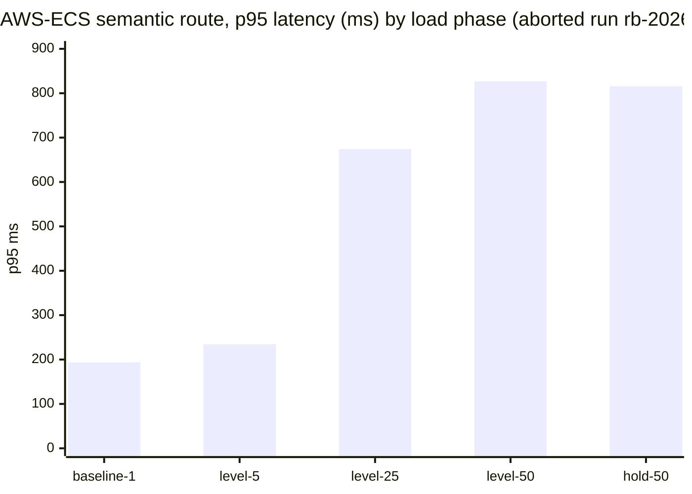
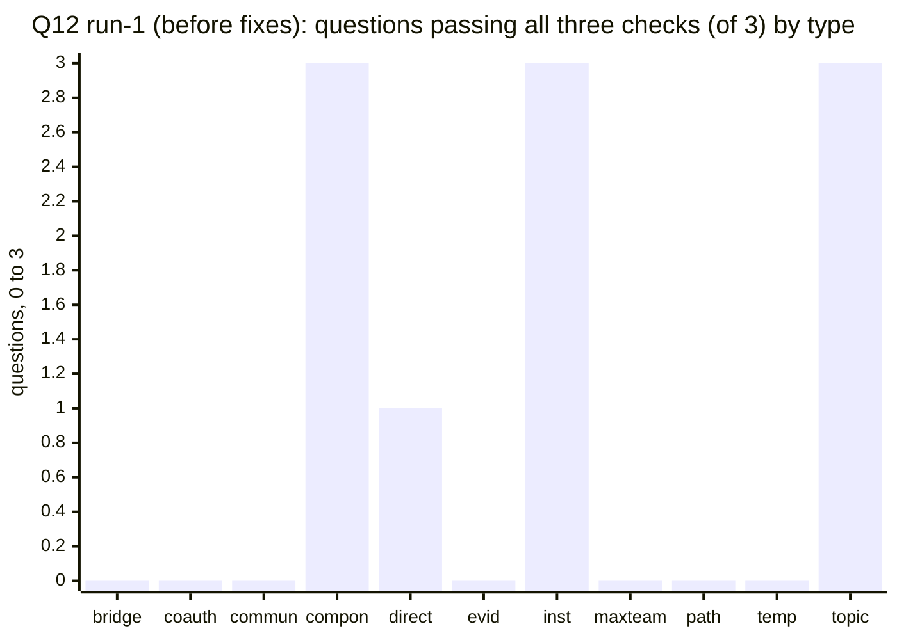
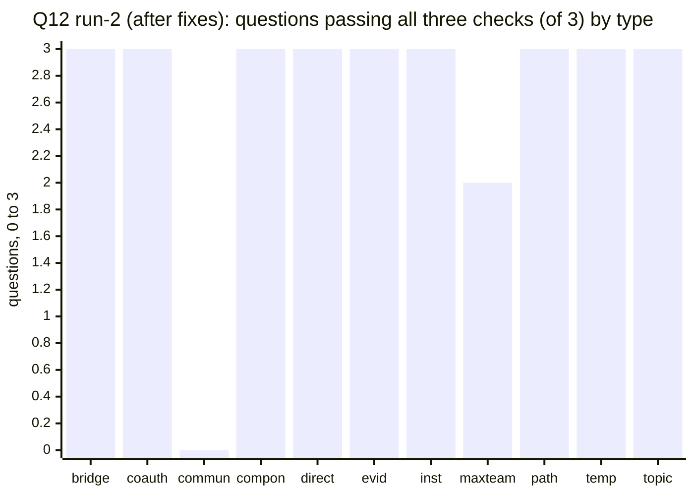

# ScholarChain evaluation

This is the submission version of the Phase 16 evaluation: methods, pointers to the raw and derived results, the main tables, plots, uncertainty and threats to validity. It is a tighter copy of [report/evaluation.md](report/evaluation.md), which stays as the Phase 16 record and holds the full tables, per-stratum splits, per-phase factory counts and every gap. Every number below is copied from a frozen results file under [experiments/results/phase16/](../experiments/results/phase16/). Nothing was re-run on AWS or against a model for this document. Measured facts and interpretation are kept apart.

## 1. Result files and the scripts that wrote them

| Group | Question | Results file (derived) | Script | Raw or input |
|---|---|---|---|---|
| 1 | Entity resolution quality | [identity-metrics.md](../experiments/results/phase16/identity/identity-metrics.md) | `experiments/scripts/eval16_identity.py` | Phase 5E labels and predictions |
| 2 | Graph correctness | [graph-correctness.md](../experiments/results/phase16/graph/graph-correctness.md) | `experiments/scripts/eval16_graph.py` | one local Spark export, run `run:ba7402d1-959a-4277-8c6e-e92878a38afa` (git-ignored) |
| 3 | Retrieval | [retrieval-metrics.md](../experiments/results/phase16/retrieval/retrieval-metrics.md) | `experiments/scripts/eval16_retrieval.py` | Q12 raw, S3 Vectors smoke record |
| 4 | Answer quality and cost | [answer-quality.md](../experiments/results/phase16/answers/answer-quality.md), [run-1 scores](../experiments/results/phase16/answers/q12-run-1-scores.md), [run-2 scores](../experiments/results/phase16/answers/q12-run-2-scores.md) | `experiments/scripts/eval16_answers.py` with `q12_score.py` | [frozen Q12 and 16B raw](../experiments/results/phase16/q12-raw/) |
| 5 | Performance and elasticity | [performance-metrics.md](../experiments/results/phase16/performance/performance-metrics.md) | `experiments/scripts/eval16_perf.py` | [frozen AWS load raw](../experiments/results/phase16/performance/raw-rb-20261118/); local P35 raw is hash-only |
| 6 | Agentic factory | [factory-metrics.md](../experiments/results/phase16/factory/factory-metrics.md), [factory-notes.md](../experiments/results/phase16/factory/factory-notes.md) | `experiments/scripts/eval16_factory.py` | `docs/agent-runs/phase-01` to `phase-15` records |
| 7 | Reproducibility | [reproducibility-evidence.md](../experiments/results/phase16/reproducibility/reproducibility-evidence.md), [check-runs-local.md](../experiments/results/phase16/reproducibility/check-runs-local.md), [regeneration-check.log](../experiments/results/phase16/reproducibility/regeneration-check.log) | `experiments/scripts/eval16_repro.py` | committed records; git-ignored local files |

Manifest for groups 1, 2 and 4: [16-evaluation.json](../experiments/manifests/16-evaluation.json). Raw-output freeze (secret-pattern scan, per-file hashes): [freeze-report.json](../experiments/results/phase16/q12-raw/freeze-report.json) and `experiments/results/phase16/q12-raw/SHA256SUMS`. Method notes: the Phase 16 section of [experiments/README.md](../experiments/README.md).

## 2. Read this first

- **Q12 run-1 and run-2 ran different code.** Run-1 used commit `ec675d562d9e923f36885d8dc9bd27c04d59b719`; run-2 used `827fcd5a425c6da65143c3460f36e00673772fc3`. They are a before/after pair, not repeats. There is one run per code version, so variability across repeats is unmeasured.
- **Local numbers are not AWS numbers.** Each table keeps the environment label of its source (AWS-ECS, AWS-ECS-LLM, AWS-EMR, LOCAL-LOOPBACK-LLM, LOCAL-LOOPBACK-DOCKER, LOCAL-MAC, AWS-S3VECTORS+VOYAGE). The Q12 runs are LOCAL-LOOPBACK-LLM; the 16B Session 1 run is AWS-ECS-LLM.
- **Vector-only and fused retrieval is a GAP.** No labelled vector-only or fused run exists.
- **Two Anthropic cost scopes are not added together.** See section 3, group 4.
- **The fresh-clone build was pending when Phase 16 closed.** It is a Phase 17 gate (17G) and is not claimed here. See [reports/release-manifest.md](../reports/release-manifest.md) for the test run recorded for the release.
- **Negative results stay.** They are summarised in section 5.

## 3. Methods and results by group

### Evaluation data and independence

- The Q12 questions and answer key are versioned files: `experiments/inputs/q12/answer-key.json` sha256 `6f5ef014d310136d7016447f7eefa39912e49c467a5f3bf2ec58ee1dc937a9b3`; `experiments/inputs/q12/questions.txt` sha256 `afc09952096c49ebacd61a051542295570ec9bcd39ffb72cb7a3d4fc014e4734`. Both Q12 runs used the same question file.
- The key was computed offline from the Spark export (run `run:ba7402d1-959a-4277-8c6e-e92878a38afa`) by `q12_answer_key.py`, a port of the Spark metric definitions. It was not generated by the prompt that produced the answers. The scorer `q12_score.py` reads the frozen raw answers, the key and the export.
- Limit: key and scorer were written by the same project; no independent human label set exists for answers. The entity-resolution labels are AI-drafted and reviewed by one human.
- Raw Q12 and 16B outputs were frozen read-only after a secret-pattern scan that found no matching file. The scan of the first freeze was not retained separately; every later scan is clean. `experiments/results/phase16/q12-raw/SHA256SUMS` has its own sha256 `1b085aa214cb8535d29031a2b143d5e587f86e472a7f41859da0e90be3fb5175`.

### Group 1. Entity resolution

Method: precision, recall, F1 and the confusion matrix recomputed from the Phase 5E labels and predictions with the deterministic offline policy `er-offline-uncalibrated-v2`; the LLM adjudicator was disabled (zero real-provider calls). Sample: 200 held-out queued pairs (194 binary gold, 6 uncertain, not scored) and 40 development pairs (38 binary, 2 uncertain). A positive prediction means the pair was ACCEPTED. Wilson 95% intervals; F1 has a seeded bootstrap interval (2000 resamples). Source: [identity-metrics.md](../experiments/results/phase16/identity/identity-metrics.md).

Held-out confusion matrix (194 binary pairs):

| | predicted ACCEPTED | predicted not accepted |
|---|---|---|
| gold same | TP 57 | FN 15 |
| gold different | FP 0 | TN 122 |

| metric | held-out | held-out without 22 assisted |
|---|---|---|
| binary pairs | 194 | 181 |
| TP / FP / FN / TN | 57 / 0 / 15 / 122 | 51 / 0 / 8 / 122 |
| precision | 100.0% (57/57; 93.7-100.0%) | 100.0% (51/51; 93.0-100.0%) |
| recall | 79.2% (57/72; 68.4-86.9%) | 86.4% (51/59; 75.5-93.0%) |
| F1 | 0.8837 (0.8197-0.9371) | 0.9273 (0.8750-0.9720) |
| false merge rate | 0.0% (0/122; 0.0-3.1%) | 0.0% (0/122; 0.0-3.1%) |
| accuracy among decisive pairs | 100.0% (94/94; 96.1-100.0%) | 100.0% (88/88; 95.8-100.0%) |
| decisive coverage | 48.5% (94/194; 41.5-55.4%) | 48.6% (88/181; 41.4-55.9%) |

By matching path (held-out): ExactIdentifier 55/55 correct (TP 55); HardConflict 70 pairs, all TN; Scored TP 2, FP 0, FN 15, TN 52 with recall 11.8% (2/17; 3.3-34.3%). The development slice (38 binary pairs) is in the [source file](../experiments/results/phase16/identity/identity-metrics.md) and in [report/evaluation.md](report/evaluation.md).

Accuracy note: held-out TN 122 is every gold-different pair that was not accepted: 37 REJECTED + 15 UNRESOLVED + 70 CONFLICT. Only the 37 REJECTED are an explicit rejection, so read accuracy with decisive coverage (94/194).

Gaps: blocking recall and global identity recall (no gold set independent of the blocker); calibration and threshold sweep; inter-annotator agreement (one reviewer); real-provider LLM adjudication accuracy (no real call). Threats: convenience sample of 300 queued pairs from oversampled evidence strata; AI-assisted labels with 22 assisted Researcher labels whose external checks were not retained; zero observed false positives is a statement about this sample (Wilson upper bound 3.1%). Interpretation: on this sample the matcher accepted no pair the reviewer labelled different and withheld 15 of 72 true matches; the recall gap sits in the Scored path, not in ExactIdentifier. No claim about the whole corpus follows.

### Group 2. Graph correctness

Method: the plain-CSV Neptune sidecar of one local Spark export (size S, run `run:ba7402d1-959a-4277-8c6e-e92878a38afa`, 60 files read) was streamed and checked for referential integrity, duplicates, orphans, coauthor-edge support, a seeded provenance audit (seed `eval16-graph-v1`, 50 of 228715 coauthor rows) and agreement with the Spark job's own counters. Size: 78104 node rows, 100252 graph-edge rows, 228715 coauthor-edge rows. Source: [graph-correctness.md](../experiments/results/phase16/graph/graph-correctness.md).

| check | result |
|---|---|
| graph edges with an unresolved endpoint | 0.0000% (0/100252; 0.0000-0.0038%) |
| coauthor edges with an unresolved endpoint | 0.0000% (0/228715; 0.0000-0.0017%) |
| duplicate node ids | 0.0000% (0/78104; 0.0000-0.0049%) |
| coauthor edges fully supported (all windows) | 100.0000% (228715/228715; 99.9983-100.0000%) |
| all-years joint-count recount equals stored count | 100.0000% (81181/81181; 99.9953-100.0000%) |
| sampled provenance audit: edges resolving through every step | 100.0000% (50/50; 92.8652-100.0000%) |

Orphans reported as measured: 852 of 21819 RESEARCHER nodes have no AUTHORED edge (3.9049%), 1030 have no coauthor edge in any window (4.7207%), and the lone INSTITUTION node has no incident edge. Support-table checks pass (269753 = 269753; 267597 = 267597). Gaps: Parquet support rows and integrity tables are not read offline; agreement with upstream source records needs an independent gold set. Threats: one export only; the CSV sidecar comes from the same Spark tables, so a common defect would not show; the audit checks internal consistency, not facts against DBLP, OpenAlex, Crossref or ORCID. Interpretation: no edge dangles and no key is duplicated; this does not show that identity decisions or source facts are correct.

### Group 3. Retrieval

Method: (A) graph-mode ranking retrieval against the answer key on the Q12 ranking questions (LOCAL-LOOPBACK graph mode; 7 ranking questions, 6 scorable); (B) the scorer's per-question retrieval check as a pass rate on 27 answer-expected questions per run; (C) an S3 Vectors known-item smoke (AWS-S3VECTORS+VOYAGE, live 2026-11-18, stack destroyed afterwards). Source: [retrieval-metrics.md](../experiments/results/phase16/retrieval/retrieval-metrics.md).

| type | questions | P at K vs key top-100 | MRR (key rank-1) | nDCG at K graded |
|---|---|---|---|---|
| bridge | 3 (3 scorable) | 0.75 | 0.6667 | 0.8304 |
| coauthor_breadth | 3 (3 scorable) | 0.8889 | 1.0 | 0.9141 |
| all scorable | 7 (6 scorable) | 0.8194 | 0.8333 | 0.8722 |
| all 7, q03 counted at its measured 0 (lower bound) | 7 | 0.7024 | 0.7143 | 0.7476 |

The max_team_size question (q03) is excluded from "all scorable" because all 100 key entries tie at the value 15 and the key keeps the first 100 by id order. No interval is given (n = 7 questions).

| run (commit) | scorer retrieval pass, answer-expected |
|---|---|
| q12-run-1 (ec675d5) | 15 / 27 = 0.5556 [0.3731, 0.7241] |
| q12-run-2 (827fcd5) | 23 / 27 = 0.8519 [0.6752, 0.9408] |

Cited evidence items resolved: run-1 86 of 86; run-2 101 of 101. S3 Vectors smoke (`voyage-4-lite`, dimension 256): 5 known-item queries, expected neighbour found 5 (hit rate 1.0, Wilson 95% [0.5655, 1.0]); pointers verified 7.

| mode | status |
|---|---|
| graph-only | measured on 7 Q12 ranking questions |
| vector-only | **GAP** |
| fused | **GAP** |

Threats: the key is a port of the Spark metrics by the same repository; 7 ranking questions; run-1 and run-2 retrieved identical lists, so they are not independent samples; the smoke queries are the stored texts themselves (n = 5) and overstate quality for novel questions. Interpretation: the pass-rate change from 15 of 27 to 23 of 27 is a before/after change in code, not noise; the graph-only versus vector-only versus fused comparison cannot be made from the existing evidence.

### Group 4. Answer quality and cost

Method: 33 Q12 questions per run (11 types, 3 each; 27 answer-expected, 6 abstain-expected), scored by `q12_score.py` against the key and the export. The primary claim figure is the **independent claim re-check**: of the claims the runtime marked verified, the share whose values the scorer re-checked against the export. The runtime's own verification rate comes from its `/v1/explain` counters and is **not independent**. Environment: LOCAL-LOOPBACK-LLM (client, service and graph export on one machine, live model). Run records: run-1 2026-11-20T21:34:35.759Z to 21:36:40.865Z; run-2 2026-11-21T17:08:30.609Z to 17:11:05.721Z. Source: [answer-quality.md](../experiments/results/phase16/answers/answer-quality.md).

| measure | run-1 (before fixes) | run-2 (after fixes) |
|---|---|---|
| answer-expected questions answered | 55.6% (15/27; 37.3-72.4%) | 85.2% (23/27; 67.5-94.1%) |
| text pass of answered | 26.7% (4/15; 10.9-52.0%) | 100.0% (23/23; 85.7-100.0%) |
| all three checks, of answer-expected | 14.8% (4/27; 5.9-32.5%) | 85.2% (23/27; 67.5-94.1%) |
| **independent claim re-check (primary)** | 100.0% (36/36; 90.4-100.0%) | 100.0% (65/65; 94.4-100.0%) |
| runtime self-reported verification (**not independent**) | 100.0% (36/36; 90.4-100.0%) | 100.0% (65/65; 94.4-100.0%) |
| contradiction rate of verified claims | 0.0% (0/36; 0.0-9.6%) | 0.0% (0/65; 0.0-5.6%) |
| correct abstentions on abstain-expected | 100.0% (6/6; 61.0-100.0%) | 100.0% (6/6; 61.0-100.0%) |
| wrong abstentions or refusals on answer-expected | 44.4% (12/27; 27.6-62.7%) | 11.1% (3/27; 3.9-28.1%) |
| errors on answer-expected | 0 | 1 |

Claims within one question are not independent, so both claim intervals understate uncertainty.

**Negative result: the 4 run-2 answer-expected failures**

| question | type | outcome |
|---|---|---|
| q08 | community | abstained (HTTP 200) |
| q14 | max_team_size | error (HTTP 504) |
| q19 | community | refused (HTTP 422) |
| q30 | community | refused (HTTP 422) |

**Negative result: run-1.** Only 4 of 27 answer-expected questions passed all three checks; of the 15 answered questions, 11 failed the text check (the rank-1 researcher or the coauthor list was absent from the prose). **16B Session 1** (AWS-ECS-LLM, 2026-11-14, 40 questions, commit `b6dc94d`): component 7/8 and ranking 7/8 answered; direct coauthors **0/14** and path **0/10**, all "Insufficient verified evidence" abstentions. "Answered" is not a correctness judgement; there is no key for these 40 questions.

Probes (one question each, not in the totals): probe-1 (commit `ec675d5`, q04): status 200, claims [1, 1, 0]; probe-2 (commit `827fcd5`, q06): status 200, claims [2, 2, 0].

**Cost (two Anthropic scopes that are not added together).** Rates: USD 0.10 per 1M input tokens and USD 0.50 per 1M output tokens (`load-tests/config/load-profile.v1.json`).

| scope | figure | source and limit |
|---|---|---|
| Anthropic, Q12 key (CS441-key), 2026-11-20 and 2026-11-21 UTC | **USD 0.08** (Console: 0.04 on each day) | cost of record for that key; user-supplied screenshot as of 2026-11-21T23:33Z; two-decimal display; the key was revoked on 2026-11-21 |
| token-derived synthesis-only, same runs | USD 0.039535 | lower bound: planner calls are not recorded, one demo answer is not in the frozen raw |
| Anthropic, earlier phases (Session 1 16B and 14C), a different key | USD 0.08 (ledger USD 0.075075; receipt figure 0.08) | [cost-report.log](../docs/agent-runs/phase-15/evidence/session-2/c11/cost-report.log) line 4; the 16B run-record estimate is USD 0.054600 |

Per-provider table of the project cost report (as of 2026-11-20T15:48:56Z, [cost-report.log](../docs/agent-runs/phase-15/evidence/session-2/c11/cost-report.log)): AWS USD 17.88 (Cost Explorer 2026-11-01..2026-11-20, credits excluded), Anthropic USD 0.08 (earlier phases only), Voyage AI USD 0.00 (dashboard, unverified for the R-b window), combined USD 17.96 against the USD 25.00 ceiling, remaining USD 7.04. The Q12 scope (Console USD 0.08) began later and is **not** in that combined figure; no single total including both Anthropic scopes is stated.

Gaps: no human-rated usefulness rubric; no check of prose contradictions; no repeats; no correctness check of the 16B answers; planner tokens not recorded. Threats: key and scorer by the same project; the question set is fixed at 33; 3 questions per type give very wide per-type intervals; run-2 passing is not evidence of stability.

### Group 5. Performance and elasticity

Method: percentiles are nearest-rank; each load level was run once. Source: [performance-metrics.md](../experiments/results/phase16/performance/performance-metrics.md). AWS-ECS run `rb-20261118` (semantic route, LLM disabled, deployed query-api behind the ALB, commit `bd0b818`, 2026-11-18T20:43:32.897Z to 20:52:54.484Z) was **aborted** by the load generator's 5xx guard; its 11 MB raw is frozen under [raw-rb-20261118](../experiments/results/phase16/performance/raw-rb-20261118/).

| phase | workers | requests | req/s | p50 ms | p95 ms | p99 ms | errors (rate) |
|---|---|---|---|---|---|---|---|
| warmup | 1 | 150 | 3.385 | 257.893 | 402.832 | 688.039 | 0 (0.0) |
| baseline-1 | 1 | 600 | 9.111 | 98.865 | 193.556 | 244.924 | 0 (0.0) |
| level-5 | 5 | 3000 | 36.145 | 123.483 | 234.663 | 300.675 | 0 (0.0) |
| level-25 | 25 | 8613 | 57.279 | 409.728 | 674.098 | 800.243 | 0 (0.0) |
| level-50 | 50 | 12575 | 69.58 | 733.056 | 826.71 | 899.765 | 0 (0.0) |
| hold-50 | 50 | 2024 | 54.245 | 726.025 | 815.533 | 5189.981 | 67 (0.033103) |

Error burst in `hold-50`: 67 failed requests (status codes 0: 2, 503: 49, 504: 16), all started between 2026-11-18T20:52:44.209Z and 20:52:49.770Z. The 1,800 s cooldown-observe phase was skipped.

Elasticity (poll brackets, not a delay measurement; median poll interval 61.0 s): last poll before scale-out 2026-11-18T20:51:54Z, state [1, 1, 0]; first poll desired=2 at 20:52:55Z, state [2, 1, 1]; first poll running=2 at 20:53:56Z; task start upper bound 61.0 s; scale-in bracket [427.517, 1360.517] seconds after load stop. A human reading of the dashboard clip (not a raw export) records HealthyHostCount 1 to 2 at about 20:54-20:55Z and 2 to 1 at about 21:09-21:10Z, CPU max 75.79%, request peak 4.21K per minute.

Failure injection (stop-task, probes about every 6 s): stop-task 21:37:55Z, recovery 113 s (observed outage 71 s); stop-task 21:45:19Z, recovery 68 s (observed outage 47 s); the middle event (21:41:16Z, a repeat on an already-stopped task) had no effect.

| run | environment | n | p50 ms (95% CI) | p95 ms | p99 ms |
|---|---|---|---|---|---|
| q12-run-1 | LOCAL-LOOPBACK-LLM | 33 | 3002.443 [1716.664, 3140.368] | 4731.616 | 4742.518 |
| q12-run-2 | LOCAL-LOOPBACK-LLM | 33 | 3396.397 [3193.561, 3615.787] | 7076.662 | 7916.488 |
| 16b-1 | AWS-ECS-LLM | 40 | 2582.504 [2323.254, 3600.209] | 6741.923 | 8582.307 |

EMR (AWS-EMR size-100 run `15a-emr-size-100-20261118T163203Z-87466`, m5.xlarge core, r5.xlarge primary): stage-in, hadoop-prep, entity-resolution and spark-class-origin COMPLETED; **the spark-job step FAILED**, so EMR has no Spark runtime to report. Step times are upper bounds from submission instants. hadoop-prep input records per second (INPUT counter 290343): local 7904.792, EMR (lower bound) 592.537; Hadoop counters were identical on EMR and local. EMR billing window 2377.157 s at USD 0.555/h, measured USD 0.37. S3 Vectors ingest: 10000 vectors in 2778.273 s = 3.599 vectors/s, concurrency 8, rejected 0.

Gaps: scale-out and scale-in delay as single numbers; throughput at 2 tasks versus 1 task; repeats of the AWS load run; Neptune and DynamoDB latency under load; EMR scaling and any complete EMR run. Threats: single runs; local rows share the laptop with the load generator; the AWS run used the semantic route only and covers about 32 s of hold-50; the 83 MB local P35 raw is hash-only; a clean clone cannot rerun `eval16_perf.py` (it also needs git-ignored inputs and exits 3; `eval16_repro.py --verify` would show PARTIAL for performance). Interpretation: on AWS the semantic route held 0 errors through level-50 and p95 grew from 193.556 ms to 826.71 ms; the first errors came in hold-50 as a burst of 503 and 504 responses that ended the run before the second task was running. No scaling claim (speed-up with size, or throughput at 2 tasks) follows.

### Group 6. Agentic factory

Method: line-level items (verdicts, findings, repair-round headings, BLOCKED-ON lines, guard-block mentions) parsed with documented regexes from `docs/agent-runs/phase-01` to `phase-15`. Counts approximate what was written down. Phases 01-04 are scored as one whole-phase unit each; phases 05-15 per subphase or work order, so the first-pass figure mixes two granularities. Source: [factory-metrics.md](../experiments/results/phase16/factory/factory-metrics.md), [factory-notes.md](../experiments/results/phase16/factory/factory-notes.md).

| measure | total (phases 01-15) |
|---|---|
| APPROVE verdict lines | 65 |
| REQUEST-CHANGES verdict lines | 62 |
| review units | 38 |
| review units approved at the first verdict | 8 |
| finding lines (distinct) | 378 (336) |
| findings by normalised severity | high 62, medium 115, low 143, info 58 |
| repair-round headings | 61 |
| reports with STATUS BLOCKED-ON | 27 |
| BLOCKED-ON OWNER fields naming a role | 93 |
| guard-block mentions (prose only) | 14 |

Gaps: no per-agent acceptance rate; no log-derived count of hook blocks. Threats: heuristic parsing; unrecorded events are not counted; phases 1-5 used external reviewers and phases 12-15 the code-reviewer subagent, so rates are not comparable across eras; no second parser. Interpretation: first-pass acceptance was low on this count (8 of 38 review units); how many unsafe actions the guard prevented cannot be stated.

### Group 7. Reproducibility

Source: [reproducibility-evidence.md](../experiments/results/phase16/reproducibility/reproducibility-evidence.md). A check counts as done only where a record shows it.

| check | status (as of Phase 16) |
|---|---|
| clean-checkout build | **PENDING, Phase 17: not done** at the time of the Phase 16 record |
| bounded pipeline replay | PARTIAL: local P6 chain replayed repeatedly; same Hadoop counters on EMR and locally; no end-to-end EMR replay (the Spark step failed) |
| deployment from an approved plan | DONE in Session 2 (2026-11-18); stack destroyed afterwards; every mutating stage ran after an approval record bound to the plan sha256 |
| regeneration of reported tables | every Phase 16 table is written by a committed `eval16_*.py` script; tables with git-ignored inputs regenerate only on the machine that holds them |

Local replays of the P6 chain (LOCAL-MAC, size S): 6 passing runs at three commits (`7a02de2`, `9e881a2`, `bd0b818`); the input tree sha256, Hadoop counters, Spark counters, CSV sidecar total bytes (467188886) and ER policy and config hashes each have 1 distinct value. The physical Parquet export differs slightly (export files 433 or 435; reason not recorded). The regeneration log ends `REGENERATION: PASS pass=24 fail=0 skipped_scripts=0` on the machine that holds the raw inputs; in a clean clone the tables with git-ignored inputs would SKIP and the result would be PARTIAL.

## 4. Plot: Q12 all-three pass count by question type

Data: [answer-quality.md](../experiments/results/phase16/answers/answer-quality.md) (3 questions per type; the same question file in both runs; institution and topic are abstain-expected and count correct abstentions).

| type | run-1 | run-2 |
|---|---|---|
| bridge | 0/3 | 3/3 |
| coauthor_breadth | 0/3 | 3/3 |
| community | 0/3 | 0/3 |
| component | 3/3 | 3/3 |
| direct_collab | 1/3 | 3/3 |
| evidence | 0/3 | 3/3 |
| institution (abstain-expected) | 3/3 | 3/3 |
| max_team_size | 0/3 | 2/3 |
| shortest_path | 0/3 | 3/3 |
| temporal | 0/3 | 3/3 |
| topic (abstain-expected) | 3/3 | 3/3 |

The table above is the authoritative form; the two charts show run-1 and run-2 separately.

## 5. Uncertainty and negative results in one place

- Intervals are Wilson 95% unless stated; claim intervals treat each claim as an independent trial and so understate uncertainty. A per-type interval on n = 3 is [0.4385, 1.0] at 3 of 3 and [0.0, 0.5615] at 0 of 3.
- Single runs everywhere: there is no run-to-run interval for answers, AWS load or EMR.
- Q12 run-1: 4 of 27 answer-expected questions passed all three checks (14.8%); 12 were abstained or refused.
- Q12 run-2: 4 answer-expected failures (q08, q14, q19, q30); all three community questions failed in both runs.
- 16B Session 1: 0 of 14 direct-coauthor and 0 of 10 path questions were answered.
- Entity resolution: 15 of 72 true held-out matches were withheld; Scored-path recall 2/17.
- Graph: 852 RESEARCHER nodes without an AUTHORED edge; the lone INSTITUTION node has no incident edge.
- AWS load run `rb-20261118`: aborted after a burst of 67 failed requests; the cooldown phase never ran.
- AWS-EMR: the size-100 Spark step failed; the five size-25 runs of 2026-11-14 ended with non-zero exit codes and no Hadoop counters.
- Factory: 8 of 38 review units approved at first review.
- Retrieval: vector-only and fused comparison is a GAP.

## 6. Threats to validity (consolidated)

1. **Same-project key and labels.** The Q12 key, scorer and ER labels were produced inside the project; no independent blind gold set exists.
2. **Convenience samples.** 300 queued ER pairs from oversampled strata; 33 designed Q12 questions; one bounded graph export (size S, one DBLP slice of 10,577 works).
3. **Before/after, not repeats.** Q12 run-1 and run-2 differ in code; run-2 pass counts do not show stability.
4. **Environment mixing.** Local loopback numbers are not AWS numbers; the AWS load run used only the semantic route, and only about 32 s of hold-50 completed.
5. **Internal consistency is not truth.** Graph checks read a sidecar derived from the same tables; they do not check facts against DBLP, OpenAlex, Crossref or ORCID.
6. **Unrecorded quantities.** Planner-call tokens and per-service load cost were not recorded; the Console cost is a two-decimal screenshot.
7. **Heuristic factory parsing.** Formats differ by phase and no second parser cross-checked the counts.
8. **Machine-bound regeneration.** Tables with git-ignored inputs regenerate only on the machine that holds them; the AWS stack that held the vector index was destroyed on 2026-11-18.

## 7. Where each number can be re-derived

| To re-derive | Command (from the repository root) | Needs |
|---|---|---|
| all Phase 16 tables, byte for byte | `python3 -I experiments/scripts/eval16_repro.py --verify` | the git-ignored raw inputs on the author's machine; a clean clone gives PARTIAL |
| identity table | `python3 -I experiments/scripts/eval16_identity.py --out-dir <dir>` | committed Phase 5E labels |
| manifest check | `python3 -I experiments/scripts/check_manifests.py` | none |

Replay in 17A (2026-11-22, the author's machine, offline): `python3 -I experiments/scripts/eval16_repro.py --verify` ended `REGENERATION: PASS pass=24 fail=0 skipped_scripts=0` with exit status 0 (23 regenerated result files matched byte for byte, plus the frozen `raw-rb-20261118` input verified). `python3 -I experiments/scripts/check_manifests.py` was also replayed in 17A and ended `RESULT: OK (placeholders allowed; run with --final before the commit freeze)` with 106 file hashes verified. The identity command was not replayed on its own in 17A (replay in 17G); it is listed with the flag the verify mode passes to every script.
