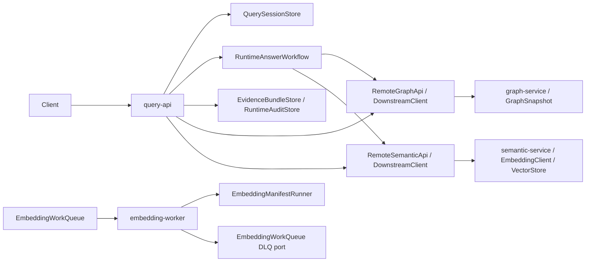

# ScholarChain REST services

Phase 10 provides four Java 17 / Scala 3.3.4 artifacts from one service distribution:
`QueryApiMain`, `GraphServiceMain`, `SemanticServiceMain`, and `EmbeddingWorkerMain` in
`edu.uic.cs441.scholarchain.services`. Cask 0.10.2 transports HTTP and delegates parsing,
authentication and dispatch to `ApiApplication`; application services call typed ports.
No route handler implements retrieval, metric computation, synthesis or verification.

The committed [OpenAPI contract](src/main/resources/openapi/scholarchain.v1.yaml) documents
public and internal routes. JSON in `src/main/resources/openapi/examples` is explicitly
synthetic format material, never a claim about a real researcher or deployed answer.

## Route and dependency graph

| Artifact | Routes and work |
| --- | --- |
| query-api | POST `/v1/query`; GET `/v1/jobs/{jobId}` and `/result`; GET `/v1/evidence/{evidenceId}`; GET `/v1/queries/{queryId}/evidence`; GET `/v1/explain/{queryId}`; graph proxy routes below |
| query-api, graph-service | GET `/v1/graph/nodes/{nodeId}` and `/neighbors` |
| graph-service | GET `/internal/v1/graph/nodes/{nodeId}` and `/neighbors`; GET `/internal/v1/graph/metrics/{nodeId}`; GET `/internal/v1/graph/paths` |
| semantic-service | POST `/internal/v1/semantic/retrieve` |
| query-api | POST `/internal/v1/semantic/retrieve` forwards to the configured semantic service |
| query-api | POST `/v1/semantic/retrieve`: public, API-key authenticated, rate limited, forwards to the internal semantic route (see "Public semantic retrieval") |
| all artifacts | GET `/healthz`, `/readyz`, `/metrics` |
| embedding-worker | Bounded `EmbeddingWorkQueue` consumer, durable per-payload processing reservation, separate DLQ queue port |



`ExtendedApi` injects evidence, graph and semantic application services. `RemoteService` uses
Java HTTP clients wrapped by `DownstreamClient`; graph and semantic have separate circuit
breakers and registered metrics. Public graph ingress through query-api is a thin proxy to
internal graph endpoints. The explicit offline runtime also uses remote graph metrics and
semantic retrieval ports when both service URLs are configured. Runtime answers still pass
the real evidence builder, synthesis verifier and immutable audit store before publication.

## Execution modes and local run

All main classes require distinct `SCHOLARCHAIN_API_KEY_SHA256` and
`SCHOLARCHAIN_INTERNAL_TOKEN_SHA256`; there are no fallback credentials. Invalid/missing
configuration exits **2**, including malformed worker configuration before a listener starts.
Default `SCHOLARCHAIN_SERVICE_MODE=unconfigured` keeps liveness 200 and readiness 503 and
refuses query work. It never silently selects synthetic data as a production fallback.

Set `SCHOLARCHAIN_SERVICE_MODE=offline-synthetic` to explicitly run the declared Phase 9 G1
fixture. This mode creates only fake stores and a scripted model; no AWS SDK/provider client
or credentials are discovered. Its supported question is exactly:

```json
{"question":"Synthetic fixture: publication count for A","output":{"includeScores":false}}
```

A real `RuntimeAnswerWorkflow` retrieves fixture evidence, a scripted proposal copies its
publication-count value, `ClaimVerificationAgent` checks it, and the audit is persisted.
Other questions or mismatched structured constraints return typed 422 rather than invented
answers. All fixture identities and overlays are synthetic, as declared in `RuntimeOfflineFixture`.
The independently owned test fixture supplies separate hand-derived expected values.

Configure `SCHOLARCHAIN_GRAPH_BASE_URI` and `SCHOLARCHAIN_SEMANTIC_BASE_URI` together on
query-api to use independently running service artifacts. These HTTP(S) base URLs are runtime
inputs; URI user-info is forbidden. Supply `SCHOLARCHAIN_INTERNAL_TOKEN` through deployment
secret injection for outgoing calls and ensure its hash matches the internal-token hash.
The raw token is never logged, returned or committed. In that composition query execution
reads actual remote graph metric records and actual remote semantic hits, and graph exploration
is proxied to the graph artifact. Both dependency readiness checks must succeed for readiness
200. In `unconfigured` and `offline-synthetic` modes no request is sent to an AWS or paid model
endpoint by these entrypoints; only `aws` mode (below) constructs AWS clients.

Graph-service and semantic-service in offline mode use immutable fake graph/vector ports.
The semantic index starts empty and returns truthful empty hits; it never invents context.
Embedding-worker starts a bounded loop over an empty fake queue with a real
`ManifestEmbeddingProcessor`/`EmbeddingManifestRunner`; injection tests enqueue actual bounded
synthetic work. Offline mode is not a live production adapter configuration; the live
composition is the separate `aws` mode below.

The distribution contains `services.jar`, `lib/`, and required `prompts/runtime` and
`prompts/schemas` assets. Build with `sbt packageServices` on JDK 17; Docker's `MAIN_CLASS`
build argument selects one of the four allowed mains. Container listeners require
`SCHOLARCHAIN_HTTP_HOST=0.0.0.0` explicitly. Images are built locally without a registry push.

## Local query stack over a Phase 6 export (no AWS)

`LocalQueryStackMain` runs the real query workflow on a laptop with **no AWS call and no AWS SDK
client**: one JVM starts the same three roles as `aws` mode (semantic-service, graph-service,
query-api) through the same `ServiceBootstrap.launch`, all bound to **loopback only**, with
`LocalPortFactory` as the port factory. It loads one completed Phase 6 Spark export once
(`LocalExportStores`, storage module: hash-verified, about 200 s for the size-S export) and serves
it from memory.

| Port group | Local source |
|---|---|
| graph-service (`GraphPorts`) | `stores.graphReader` and `stores.metrics`. The local reader sits only behind the graph role (`LiveGraphSnapshot` / `GraphApi`); the query workflow reaches the graph through `RemoteGraphReader` over HTTP to the graph role, exactly as on AWS. `QueryPorts` has no graph reader. |
| query-api (`QueryPorts`) | fresh in-memory sessions, evidence bundles and audit store; `stores.entityLinks`, `stores.metrics`, `stores.objects`, `stores.runtimeArtifacts`; the Anthropic client built by `RagProviderClients.anthropic` exactly as `AwsSdkPortFactory` does |
| semantic-service (`SemanticPorts`) | **not served**: an empty vector index and an embedder that always refuses (`local-semantic-not-served`). There are no vectors and no Voyage key. |
| worker | not served (`local-stack-has-no-embedding-worker`); query jobs use the in-process `QueryService` pool as always |

Retrieval mode: the stack defaults to `SCHOLARCHAIN_RUNTIME_RETRIEVAL_MODE=graph`, so no semantic
query is planned and answers are not flagged partial because a semantic stage failed. `fused`
is accepted (the semantic stage then fails per query and the answer is partial). The variable is
a general override of the packaged `retrievalMode` (graph or fused; vector is refused) and is unset
in `aws` mode. Consequence: an operation that needs semantic evidence ("Explain the research
collaboration of X", `SemanticExplanation`) cannot be answered locally and abstains.

Configuration (environment, plus arguments):

- `SCHOLARCHAIN_API_KEY_SHA256` (required): SHA-256 of the API key clients send as `Authorization: Bearer`.
- `SCHOLARCHAIN_ANTHROPIC_API_KEY` (optional): the real key, handed only to the provider seam. Without it the stack
  still starts and is ready, and `POST /v1/query` answers 503 `MODEL_NOT_CONFIGURED` (not retryable) without any call.
- `SCHOLARCHAIN_HTTP_HOST` (default and the only accepted value `127.0.0.1`; `::1`, `localhost` and anything else exit 2, because the peer URIs and the readiness probe are IPv4 loopback) and
  `SCHOLARCHAIN_HTTP_PORT` or `--port N` (default 8080; the graph and semantic roles use ephemeral loopback ports and a
  random per-run internal token that never leaves memory).
- `--export-dir DIR` or `SCHOLARCHAIN_LOCAL_EXPORT_DIR`: the Spark export root. There is no default.
- `--include-list FILE` or `SCHOLARCHAIN_LOCAL_INCLUDE_LIST`: serve the runtime artifact as the bounded include-ids subset
  (as deployed on AWS) instead of the whole export. The graph, metric and entity-link stores are always the whole export.
- `--scratch-dir DIR` (cache loader staging, about 2 GB for size-S), `--no-verify` (skip the table-hash recomputation).
- Other `SCHOLARCHAIN_*` knobs of the service config pass through (secrets and `SCHOLARCHAIN_APPLICATION_REGION` are dropped;
  the region is the placeholder `us-local-1`). The AWS-shaped values the shared config reader insists on are fixed placeholders
  named `local-unused-*`.

Deadline profiles (non-secret; the effective values are printed in the ready line):

| Profile | Environment | Effective |
|---|---|---|
| **packaged** (default, faithful to AWS) | none | planner 5000 ms, synthesis 5000 ms, runtime synchronous 30000 ms, service synchronous 15000 ms, workflow 60000 ms |
| **raised** (a real model may exceed 5 s per stage) | `SCHOLARCHAIN_RUNTIME_PLANNER_DEADLINE_MS=15000 SCHOLARCHAIN_RUNTIME_SYNTHESIS_DEADLINE_MS=30000 SCHOLARCHAIN_RUNTIME_SYNCHRONOUS_DEADLINE_MS=60000 SCHOLARCHAIN_SYNCHRONOUS_DEADLINE_MS=70000 SCHOLARCHAIN_WORKFLOW_TIMEOUT_MS=70000` | planner 15000, synthesis 30000, runtime synchronous 60000, service synchronous 70000, workflow 70000 |

The runtime synchronous deadline must be at least the critical path of the stage deadlines (60000 ms for planner 15000 and
synthesis 30000, `RuntimeConfigValidation`); the service synchronous and workflow deadlines must cover it. A set that does not
fit is refused at preflight (`runtime-config-invalid`), before the export is read.

Preflight checks (host, key hash, port, key shape, and the full parse of the retrieval mode, every deadline and every service knob) run before the export is read. Exit codes: 2 configuration refusal,
3 refused export or include list. Output is one `local-query-stack ready ...` line (port, retrieval mode, model id, the effective deadlines, `llm=anthropic|unconfigured`,
run ID, artifact scope and pointer SHA-256, `hashesVerified`, load milliseconds) and short phase lines; no environment value is printed.
The dataset snapshot recorded in every answer's provenance is `local-export:<run id>`.

Launch from the repository root (the prompts are found by walking up from the working directory, or set
`SCHOLARCHAIN_PROMPTS_DIR`). JDK 17, heap of 3 GB or more:

```bash
export JAVA_HOME=/opt/homebrew/opt/openjdk@17/libexec/openjdk.jdk/Contents/Home
export PATH="$JAVA_HOME/bin:$PATH"
java -version          # must report 17
cd <repository root>
CP="$(sbt -batch -error 'export services/Runtime/fullClasspath' | tail -n 1)"
case "$CP" in *classes*) echo "classpath ok" ;; *) echo "classpath export failed: stop here" ;; esac
printf 'API key to use (kept in this shell only): '; IFS= read -r -s LOCAL_API_KEY; echo
export SCHOLARCHAIN_API_KEY_SHA256="$(printf '%s' "$LOCAL_API_KEY" | shasum -a 256 | cut -d' ' -f1)"
printf 'Anthropic key: '; IFS= read -r -s K; echo
# the key is in the environment of the java process only, so sbt and the Q12 harness never inherit it
SCHOLARCHAIN_ANTHROPIC_API_KEY="$K" java -Xmx3g -cp "$CP" edu.uic.cs441.scholarchain.services.LocalQueryStackMain \
  --export-dir "<export root>/spark" --include-list experiments/inputs/q12/include-ids.txt --port 8080
unset K
```

The `read` form above works in both bash and zsh (`read -p` does not: in zsh it reads from a coprocess and leaves the
variable empty). Check without printing: `echo ${#LOCAL_API_KEY} ${#K}` must show two non-zero lengths before you start
`java`. The launcher refuses the SHA-256 of an empty key and a blank `SCHOLARCHAIN_ANTHROPIC_API_KEY`, so a failed read
stops the launch instead of starting a stack that silently has no model.

For the no-key stack (graph and health checks only; `POST /v1/query` answers 503 `MODEL_NOT_CONFIGURED`), run the same
`java` command without the `SCHOLARCHAIN_ANTHROPIC_API_KEY="$K"` prefix. Prefix the `java` command with the raised-profile
variables of the table above to run that profile.

`java` runs in the **foreground** of this terminal and prints the ready line after about 3 minutes. Run the Q12 harness in a
**second terminal**: there set `SCHOLARCHAIN_LOAD_BASE_URL=http://127.0.0.1:8080` and read the same API key with the same
no-echo form into `SCHOLARCHAIN_LOAD_API_KEY` (`printf 'API key: '; IFS= read -r -s SCHOLARCHAIN_LOAD_API_KEY; echo;
export SCHOLARCHAIN_LOAD_API_KEY`). Stop the stack with Ctrl-C in the first terminal.

`LocalStackSpec` covers the wiring, the verified-claim round trip, the evidence and explain routes, the no-key refusal, the
loopback and key-hash refusals, key non-disclosure and the result-size bound, all with a scripted model.

## Live AWS mode (`SCHOLARCHAIN_SERVICE_MODE=aws`)

`aws` is an explicit third mode. Mode names are exact; anything else exits 2. It is composed only
from the existing `modules/storage` and `modules/rag` adapters, per role. No in-memory store, hashed
embedder, scripted model or fixture is selected, and `OfflineComposition` is never constructed;
`AwsBootstrapSpec` scans the aws sources and the aws launch path for those names. Code:
`AwsConfig` (environment contract), `AwsPorts` (SDK client factory), `AwsComposition` (roles),
`ReadinessGate`, `LiveAdapters`.

| Role | Composition |
| --- | --- |
| graph-service | `GraphApi` over `LiveGraphSnapshot`: node and edge reads from the storage-owned `NeptuneGraphReader` (`NeptuneGraphReader.connect`, which owns its SDK client) through the `DirectedGraphReader` port, metric reads from `DynamoResearcherMetricStore` (byte for byte) |
| semantic-service | `SemanticApi.fromPorts` over `BedrockEmbeddingClient` (Titan V2, on demand) and `S3VectorStore` |
| query-api | `RuntimeAnswerWorkflow` with `BedrockConverseLlmClient` for the planner and synthesis, `DynamoQuerySessionStore`, `IndexedEvidenceBundleStore` over `DynamoEvidenceBundleStore`, `ObjectStoreRuntimeAuditStore`, `DynamoEntityLinkCache`, `DynamoResearcherMetricStore`, and the existing `RemoteGraphApi` / `RemoteSemanticApi` HTTP clients |
| embedding-worker | `EmbeddingWorker` over `SqsEmbeddingWorkQueue` (queue and DLQ), `ManifestEmbeddingProcessor` with `S3ObjectStore`, `S3VectorStore`, `DynamoArtifactRegistry`, `DynamoRunLedger` and `BedrockEmbeddingClient`; durable reservation in `DynamoQuerySessionStore` |

Credentials come from the default AWS provider chain (the ECS task role). SDK retries are disabled
because each adapter owns a bounded retry policy. Every refusal exits 2 through the existing path
and prints only a closed code that names at most an environment variable, never a value or a stack
trace; no client is created before configuration validates.

### Environment contract

All values are environment variables. Nothing is compiled in: no bucket, endpoint, account, table,
queue or model identifier. "Terraform source" names the value Terraform can supply; entries marked
*none* have no Terraform output today and need a new variable or a human-provided value.

Every aws role (all required unless marked optional):

| Name | Example | Terraform source |
| --- | --- | --- |
| `SCHOLARCHAIN_SERVICE_MODE` | `aws` | literal in `modules/runtime/compute.tf` |
| `SCHOLARCHAIN_API_KEY_SHA256`, `SCHOLARCHAIN_INTERNAL_TOKEN_SHA256` | 64 hex | `service_secret_bindings` (existing) |
| `SCHOLARCHAIN_HTTP_HOST`, `SCHOLARCHAIN_HTTP_PORT` | `0.0.0.0`, `8080` | already in compute.tf |
| `AWS_REGION` | `us-east-2` | `var.aws_region` (already in compute.tf). `SCHOLARCHAIN_APPLICATION_REGION` is optional and must equal it |
| `SCHOLARCHAIN_DYNAMODB_TABLE_RUN_LEDGER` | `scholarchain-course-RunLedger` | `deployment_contract.table_names["RunLedger"]` |
| `SCHOLARCHAIN_DYNAMODB_TABLE_ENTITY_LINK_CACHE` | | `table_names["EntityLinkCache"]` |
| `SCHOLARCHAIN_DYNAMODB_TABLE_QUERY_SESSION` | | `table_names["QuerySession"]` |
| `SCHOLARCHAIN_DYNAMODB_TABLE_EVIDENCE_BUNDLE` | | `table_names["EvidenceBundle"]` |
| `SCHOLARCHAIN_DYNAMODB_TABLE_ARTIFACT_REGISTRY` | | `table_names["ArtifactRegistry"]` |
| `SCHOLARCHAIN_DYNAMODB_TABLE_RESEARCHER_METRIC_CACHE` | | `table_names["ResearcherMetricCache"]` |
| `SCHOLARCHAIN_DYNAMODB_QUERY_SESSION_INDEX` | `by-idempotency-key` | `var.query_session_gsi_name` |
| `SCHOLARCHAIN_READINESS_CACHE_MS` (optional) | default `5000`, 1..300000 | none |
| `SCHOLARCHAIN_READINESS_TIMEOUT_MS` (optional) | default `2000`, 100..30000 | none |

The six table names must be distinct. The storage adapter requires all six in every role even when
the role reads only some of them.

graph-service:

| Name | Example | Terraform source |
| --- | --- | --- |
| `SCHOLARCHAIN_NEPTUNE_ENDPOINT` | `https://<reader-endpoint>:8182` (https and explicit port) | `deployment_contract.neptune_endpoint` (`module.neptune.endpoint`) |
| `SCHOLARCHAIN_STORAGE_GRAPH_BUCKET` | | `module.datalake.bucket_names["graph"]` (not in compute.tf inputs yet) |
| `SCHOLARCHAIN_GRAPH_CURSOR_KEY` | at least 16 chars | `service_secret_bindings["graph-service"]` (existing secret) |
| `SCHOLARCHAIN_NEPTUNE_QUERY_TIMEOUT_MS` (optional) | default `5000`, 100..60000 | none |
| `SCHOLARCHAIN_GRAPH_SNAPSHOT_ID` (optional) | | none. Unset reports `neptune-live-unpinned`, which asserts no immutable snapshot |

semantic-service:

| Name | Example | Terraform source |
| --- | --- | --- |
| `SCHOLARCHAIN_S3_VECTORS_VECTOR_BUCKET` | | `deployment_contract.vector_bucket` |
| `SCHOLARCHAIN_SEMANTIC_INDEX` | `researcher-profile-v1` (one of the five `VectorIndexes` names) | a key of `module.s3vectors.index_arns` |
| `SCHOLARCHAIN_STORAGE_RAG_BUCKET` | | `module.datalake.bucket_names["rag"]` |
| `SCHOLARCHAIN_MODELS_EMBEDDING_MODEL` | `amazon.titan-embed-text-v2:0` | `var.embedding_model_id` |
| `SCHOLARCHAIN_EMBEDDING_MODEL_VERSION` | must equal the version stamped on the stored vectors | none |
| `SCHOLARCHAIN_EMBEDDING_DIMENSION` | `256` (256, 512 or 1024) | `var.vector_dimension` |
| `SCHOLARCHAIN_S3_VECTORS_METRIC` (optional) | default `cosine` | `var.vector_metric` |
| `SCHOLARCHAIN_EMBEDDING_CACHE_MAX_ENTRIES` (optional) | default `1024` (`CachingEmbeddingClient.DefaultMaxEntries`), 1..100000; refusal `invalid-aws-configuration:SCHOLARCHAIN_EMBEDDING_CACHE_MAX_ENTRIES` | none (P40 uses the default; any override rides with P41) |

query-api:

| Name | Example | Terraform source |
| --- | --- | --- |
| `SCHOLARCHAIN_GRAPH_BASE_URI`, `SCHOLARCHAIN_SEMANTIC_BASE_URI` | `http://graph-service.<ns>:8080` | already in compute.tf |
| `SCHOLARCHAIN_INTERNAL_TOKEN` | raw token, must hash to the internal hash | `service_secret_bindings["query-api"]` (existing secret) |
| `SCHOLARCHAIN_STORAGE_RAG_BUCKET` | | `module.datalake.bucket_names["rag"]` |
| `SCHOLARCHAIN_MODELS_SYNTHESIS_MODEL` | `us.anthropic.claude-haiku-4-5-20251001-v1:0` | `coalesce(var.synthesis_inference_profile_id, var.synthesis_model_id)` |
| `SCHOLARCHAIN_SYNTHESIS_MODEL_VERSION` | recorded in the audit | none; suggest `var.synthesis_model_id` |
| `SCHOLARCHAIN_MODELS_EMBEDDING_MODEL`, `_EMBEDDING_MODEL_VERSION`, `_EMBEDDING_DIMENSION` | as semantic-service | as semantic-service. query-api makes no embedding call; the triple is the identity the stored vectors must carry |
| `SCHOLARCHAIN_PROMPTS_DIR` (optional) | default: nearest `prompts` directory upward from the working directory | none |
| `SCHOLARCHAIN_RUNTIME_ARTIFACT_KEY`, `_SHA256`, `_SOURCE_RUN_ID` (optional, all or none) | `.../versions/...`, 64 hex, run id | none (published by the 14C load). Unset: every artifact read is refused |
| `SCHOLARCHAIN_RUNTIME_ARTIFACT_BUCKET` (optional) | default: the rag bucket | `module.datalake.bucket_names["artifacts"]` if used |
| `SCHOLARCHAIN_RUNTIME_DATASET_SNAPSHOT` (optional) | default `runtime-live-unpinned` | none |
| `SCHOLARCHAIN_QUERY_SESSION_TTL_SECONDS` (optional) | positive | `var.enable_query_session_ttl` |
| `SCHOLARCHAIN_EVIDENCE_INDEX_PREFIX`, `SCHOLARCHAIN_AUDIT_PREFIX` (optional) | `evidence-index`, `runtime-audit` | none |
| `SCHOLARCHAIN_RUNTIME_PLANNER_DEADLINE_MS`, `_SYNTHESIS_DEADLINE_MS`, `_SYNCHRONOUS_DEADLINE_MS` (optional) | override the packaged stage deadlines | none. The result must pass `RuntimeConfigValidation` |
| `SCHOLARCHAIN_SEMANTIC_RATE_LIMIT_PER_SECOND`, `SCHOLARCHAIN_SEMANTIC_RATE_LIMIT_BURST` (optional) | defaults `50` and `100`; 1..100000 and 1..1000000; read in every mode | none (P40 uses the defaults; the Session 2 value `r_S2` rides with P41) |

embedding-worker:

| Name | Example | Terraform source |
| --- | --- | --- |
| `SCHOLARCHAIN_SQS_QUEUE_URL`, `SCHOLARCHAIN_SQS_DLQ_URL` | https queue URLs | `deployment_contract.queue_url`, `.dead_letter_queue_url` |
| `SCHOLARCHAIN_STORAGE_RAG_BUCKET` | text bucket | `module.datalake.bucket_names["rag"]` |
| `SCHOLARCHAIN_EMBEDDING_TEXT_PREFIX` | `embedding-text` (items must lie under `<prefix>/.../versions/`) | none (14C data layout) |
| `SCHOLARCHAIN_S3_VECTORS_VECTOR_BUCKET`, `SCHOLARCHAIN_SEMANTIC_INDEX`, `SCHOLARCHAIN_MODELS_EMBEDDING_MODEL`, `_EMBEDDING_MODEL_VERSION`, `_EMBEDDING_DIMENSION`, `SCHOLARCHAIN_S3_VECTORS_METRIC` | as semantic-service. The index is the readiness probe index only | as semantic-service |
| `SCHOLARCHAIN_WORKER_VISIBILITY_TIMEOUT_SECONDS` (optional) | default `30` | `var.sqs_visibility_timeout_seconds` |
| `SCHOLARCHAIN_WORKER_WAIT_SECONDS` (optional) | default `0`, 0..20 | `var.sqs_long_poll_seconds` |
| `SCHOLARCHAIN_WORKER_MAX_ATTEMPTS`, `_BATCH_SIZE`, `_POLL_MS` (optional) | existing | none |

The synthesis value is passed unchanged as the Converse `modelId`, so an inference-profile ID is
accepted. The temperature, forced tool choice and prompt versions stay as packaged in core
(`scholarchain.runtime-config.v1.json`); only the model identity, region and the three optional
deadlines are replaced.

### Readiness semantics

Liveness (`/healthz`) is process-only in every mode and never touches a dependency. In aws mode
`/readyz` is 200 only when every check for the role passes. Checks run through the adapters' ports,
concurrently, bounded as a whole by `SCHOLARCHAIN_READINESS_TIMEOUT_MS` (a hung check is cancelled
and counts as failed), and the verdict is cached for `SCHOLARCHAIN_READINESS_CACHE_MS`, pass or
fail, with concurrent callers sharing one evaluation. Only check names are logged.

Ready means reachable and authorized, never that data is loaded: each probe reads a key no loader
writes (`readiness-probe`) and a clean "absent" answer counts as ready. An empty graph, empty
vector index and empty tables are ready, so 14B can be healthy before the 14C load.

| Role | Check | Port call | AWS action | Granted by |
| --- | --- | --- | --- | --- |
| graph-service | neptune | graph reader `node` | `neptune-db:ReadDataViaQuery` (OpenCypher) | `modules/identity/phase12b.tf:39-41` |
| graph-service | dynamodb-metrics | metric store `get` | `dynamodb:GetItem` | `modules/identity/main.tf:74-78`, tables at `:55` |
| semantic-service | s3-vectors | vector store `get` | `s3vectors:GetVectors` | `modules/identity/phase12b.tf:47` |
| query-api | dynamodb-query-session | session store `get` | `dynamodb:GetItem` | `main.tf:74-78`, tables at `:54` |
| query-api | dynamodb-evidence-bundle | evidence store `get` | `dynamodb:GetItem` | same |
| query-api | dynamodb-metrics | metric store `get` | `dynamodb:GetItem` | same |
| query-api | dynamodb-entity-links | link cache lookup | `dynamodb:Query` | same |
| query-api | graph-service, semantic-service | peer `GET /readyz` | none (HTTP, internal) | not IAM |
| embedding-worker | sqs-queue | queue `backlog` | `sqs:GetQueueAttributes` | `main.tf:119-122` |
| embedding-worker | s3-vectors | vector store `get` | `s3vectors:GetVectors` | `phase12b.tf:47` |
| embedding-worker | dynamodb-run-ledger, dynamodb-artifact-registry | ledger `getRun`, registry `get` | `dynamodb:GetItem` | `main.tf:74-78`, tables at `:57` |
| embedding-worker | dynamodb-query-session | session store `get` | `dynamodb:GetItem` | **not granted** (see Limits) |

query-api readiness includes both peers' `/readyz`. Those calls pass through the peer circuit
breaker, so after a peer outage query-api stays not-ready until the breaker closes, up to
`SCHOLARCHAIN_BREAKER_RESET_MS` (default 30 s).

### Limits and what is not verified live

- Nothing here has run against AWS. All tests use injected ports; the SDK factory is only built
  offline with static dummy credentials and no call. IAM, endpoints, model access, Titan V2 and
  Haiku 4.5 behavior, Neptune reachability and S3 Vectors responses are unverified.
- **Graph reader and edges (storage delivered, unverified live).** `AwsSdkPortFactory` opens the
  reader through `StorageGraphReaderProvider`, which calls `NeptuneGraphReader.connect`; this module
  never names the SDK client (the independent runtime fence still passes). Construction makes no
  network call. A storage refusal exits 2 with a closed message: `invalid-aws-configuration:
  SCHOLARCHAIN_NEPTUNE_ENDPOINT`, `invalid-aws-configuration:AWS_REGION`,
  `aws-credentials-unavailable`, or `graph-reader-connect-failed`.
- **Edge semantics.** `LiveGraphSnapshot.incidentEdges` reads `directedEdges(..., Both, <the five
  served types>, ...)` page by page, passing the store's opaque cursor back unchanged, and stops one
  row past the API scan cap so the API reports `GRAPH_SCAN_CAP` rather than a silently truncated
  list. Stored start and end are reported as stored. An undirected type
  (`GraphEdgeType.isUndirected`, today COAUTHORED_WITH) has only a canonical stored order, so every
  direction filter treats it as incident. `window` constrains COAUTHORED_WITH only. A row with a
  stored `provenanceJson` reports it (plus `sourceEvidenceJson` as `evidence`). Coauthor rows carry
  no provenance record: they report `provenance: null` and an `evidence` object of their stored
  pointers (`evidenceTable`, `evidenceEdgeId`, `windowId`, `representativeWorkIds`), never an
  invented provenance. A row with neither, or with malformed stored provenance or evidence, refuses
  the whole read (`edge-provenance-absent`, `malformed-edge-provenance`, `malformed-edge-evidence`;
  the API answers 502). A bound refusal from the store (`invalid-bound`) is propagated the same
  way. The fully typed core `GraphEdge` projection stays refused
  (`core-edge-projection-unavailable`) because loaded coauthor rows cannot supply it. The
  `provenance` of a coauthor neighbor item is therefore not a `Provenance` object; clients must read
  `evidence`.
- The Cypher templates behind `directedEdges`, Neptune reachability, IAM for `ReadDataViaQuery` and
  the edge row shapes in a real loaded graph are unverified until the Phase 14C gate.
- **Embedding-worker session table (blocked on infra).** The worker's durable reservation uses the
  QuerySession table, which the worker task role cannot read or write. Its readiness reports
  not-ready (`dynamodb-query-session`) and processing would fail until the grant exists.
- **S3 existence checks (blocked on infra).** The task roles hold only object-level `s3:GetObject`
  (`modules/identity/main.tf:79-84`).
  Without `s3:ListBucket` on the bucket, S3 answers 403 instead of 404 for an absent key, so the
  adapter reports a rejection. query-api needs this to index new evidence items. S3 is therefore
  not a readiness check, and the DLQ (send-only) and Bedrock (no free action) are not probed.
- query-api retrieval over the remote graph supports node, neighbor and path reads. Community and
  cross-community reads are refused (`remote-graph-operation-unsupported`). Without a published
  artifact pointer, ranking, bridge, temporal and edge-support reads are refused.
- The semantic retrieval agent asks for a query vector before calling its vector port.
  `RemoteQueryEmbeddingCarrier` satisfies that signature with a placeholder shape that
  `RemoteVectorStore` discards; semantic-service embeds the question. A retrieval port that takes
  the question directly would remove this (rag-owned).
- The planner's model usage is not recorded in the audit `modelUsage`: the plan is produced before
  `RuntimeAnswerWorkflow.runPlan`, so that the supplied constraints are checked before retrieval.
- Stage deadlines come from the packaged runtime config (planner and synthesis 5 s) and may need
  the optional overrides for real model latency.

## Public semantic retrieval (`POST /v1/semantic/retrieve`, P40)

Served by query-api in `aws` and `offline-synthetic` mode (404 in `unconfigured` mode and on
other roles). Steps, in order:

1. **Authentication**: the same `Authorization: Bearer <API key>` as every other `/v1` route,
   checked against `SCHOLARCHAIN_API_KEY_SHA256`. Missing or wrong key: 401 `UNAUTHORIZED`. The
   internal token is not accepted here, and the API key still does not open `/internal/**`.
2. **Rate limit** (before validation and before any downstream call): an in-memory token bucket
   per API-key hash in each query-api process. Defaults 50 requests/s sustained, burst 100,
   overridable with `SCHOLARCHAIN_SEMANTIC_RATE_LIMIT_PER_SECOND` and
   `SCHOLARCHAIN_SEMANTIC_RATE_LIMIT_BURST`. Buckets are keyed by the SHA-256 of the presented key,
   never the raw key, and at most 1,024 buckets are held (fully refilled buckets are dropped first,
   then the least recently used). Over the limit: 429 `RATE_LIMITED`, `retryable: true`, with a
   `Retry-After` header in whole seconds (at least 1). The limit is per task, so N query-api tasks
   admit up to N times the configured rate. An invalid value refuses startup (exit 2) with
   `invalid-service-configuration:<variable>`.
3. **Public limits** (`PublicSemanticLimits`), typed 400 `INVALID_REQUEST` otherwise: body at most
   8,192 UTF-8 bytes; JSON object with only `question`, `topK`, `filters`; `question` a string with
   a non-whitespace character and at most 1,000 Unicode code points; `topK` a whole number 1..20
   (default 20); `filters` an object of at most 16 non-empty keys with string values of at most
   1,000 code points (the internal route's filter shape); no query string; JSON nesting at most 32
   levels (see "Request-body nesting limit" below).
4. **Forwarding**: the body is re-serialized (`question`, `topK`, optional `filters`) and sent to
   semantic-service `POST /internal/v1/semantic/retrieve` through `RemoteSemanticApi` with the
   internal token, under the existing `DownstreamClient` timeout and circuit breaker. In
   offline-synthetic mode without `SCHOLARCHAIN_SEMANTIC_BASE_URI` it calls the in-process
   `SemanticApi` instead. The internal route and its `SemanticApiConfig` limits are unchanged,
   apart from the shared request-body nesting limit.
5. **Reply**: rebuilt from exactly `hits[].key`, `hits[].distance`, `hits[].metadata` and `model`
   (`modelId`, `version`, `dimension`); any other downstream field is dropped, and a downstream body
   of another shape is a 502. At most the forwarded `topK` hits are returned: if the downstream
   returns more, the first `topK` are kept in downstream order.

Downstream errors use the existing mapping: semantic-service 503 or an open circuit is 503
(`SERVICE_UNAVAILABLE` or `CIRCUIT_OPEN`), a 504 or a transport timeout is 504
`DOWNSTREAM_TIMEOUT`, downstream throttling is 429 `THROTTLED` (no `Retry-After`), and connection
failures are 502 `DOWNSTREAM_FAILURE`. The question is not logged (request logs carry only the
route template `/v1/semantic/retrieve`, status and correlation IDs) and is never a metric label.

**Query-embedding cache.** In `aws` mode, semantic-service wraps only its query-type embedding
client, after the port factory builds it, in the rag-owned `CachingEmbeddingClient`, and passes the
wrapped client both to the vector-identity check and to `SemanticApi.fromPorts`. The embedding
worker's document client is not wrapped. The size comes from
`SCHOLARCHAIN_EMBEDDING_CACHE_MAX_ENTRIES` (default 1,024). The offline-synthetic semantic
composition wraps its deterministic embedder the same way (same variable; refusal
`invalid-service-configuration:SCHOLARCHAIN_EMBEDDING_CACHE_MAX_ENTRIES`). The cache keys on the
provider, the model and a SHA-256 of the exact text. It caches only successful embeddings, has no
TTL, and does not coalesce concurrent misses for the same text (see `modules/rag/README.md`).

**Metrics** (on `/metrics`, API key required):

| Metric | Where | Meaning |
| --- | --- | --- |
| `api_route_requests_total{route,status}` | every role | replies per route template and status; routes outside the labelled set count as `unmatched`, as in the request log |
| `api_rate_limited_total` | every role (non-zero only on query-api) | 429 `RATE_LIMITED` replies from the semantic rate limiter; downstream `THROTTLED` replies are not counted here |
| `embedding_cache_hits_total`, `embedding_cache_misses_total`, `embedding_cache_evictions_total` | semantic-service; offline-synthetic query-api with an in-process semantic route | cumulative; misses are texts sent to the underlying embedder (Voyage calls in aws mode) |
| `embedding_cache_size`, `embedding_cache_capacity` | as above | current entries and the configured bound |

## Requests, jobs and errors

`X-Request-Id` and `X-Trace-Id` are bounded safe correlation tokens, generated when absent or
invalid, returned on every application response and propagated to downstream calls. Query
constraints, analysis flags, retrieval caps and output options are validated. The runtime
adapter checks supplied filters/windows/caps against its actual plan before retrieval.
Evidence scores require an injected evidence store; they are observed retrieval signals,
not authoritative counts or invented fusion weights. Researcher rows use verified typed
claim subjects and values and stored candidate labels only; unavailable fields remain absent.
Numeric claim values remain decimal strings to preserve exact stored integers.

`Idempotency-Key` is required on query POSTs. An opaque deterministic query ID and hashed
application reservation isolate application sessions from audit/worker namespaces. Both
`Written(session)` and `Retried(_, Written(session))` enter the same body-binding path.
A revision-zero CAS binds a canonical JSON body fingerprint; only that winning binder schedules
work. Each binding attempt stores a fresh ownership token alongside its request/trace IDs,
which clients may reuse. If a binding write applies but its reply is lost (including a retried
conditional-conflict result), a primary read must match the exact intended revision and payload,
including fingerprint, request/trace IDs and ownership token, before this caller schedules it.
A competing binder can only replay that record or receive a body-conflict 409.

Other retried creation results also reconcile the authoritative primary record. Concurrent
callers wait for body binding within the configured downstream deadline; if the reservation is
still unbound, a replay may compete for the same revision-zero CAS. A clean bind rejection can
return a retryable 503 for that attempt, but leaves the key recoverable on a later request rather
than permanently stranded. Same-body replays of bound sessions return stored answers, terminal
errors or a current job reference; different bodies return 409 without running another workflow.

Synchronous wait and maximum workflow execution deadline are separate. Work exceeding only
the synchronous wait returns 202 and continues in the same bounded background worker task.
The reference reports the actual persisted QUEUED/RUNNING state. Job reads include state,
stage, timestamps, error and result URL. Workflow failures retry within the configured policy,
then persist a **nonretryable** terminal error; same-key replay cannot execute again. Queue-full
429 and oversize-result 502 are also terminal/nonretryable. A deliberate new workflow requires
a new idempotency key. Runtime-adapter failures do not retry an already published immutable audit.

**Request-body nesting limit.** Every JSON request body parsed by this module (`POST /v1/query`,
`POST /v1/semantic/retrieve` and `POST /internal/v1/semantic/retrieve`) may have at most
**32** arrays and objects open at once (`RequestJson.MaxNestingDepth`; the root object counts as
level 1). The deepest legitimate body is 3 levels (`/v1/query` `constraints.topics`). The limit is
checked by a single loop over the raw text, before ujson parses it: `[` and `{` outside strings
open a level, `]` and `}` close one, a backslash escapes the next character inside a string, and
closing more levels than were opened is also refused. A deeper body is a typed 400
`INVALID_REQUEST`. Without this check a body of a few thousand `[` (within the 8 KiB public limit)
overflowed the thread stack while ujson rendered or transformed the parsed value; that
`StackOverflowError` escaped the application and the transport printed a stack trace and answered
an untyped 500. On the public semantic route the rate limit still runs first, so a deep body over
the limit is a 429. Separately, and only as a backstop, `ApiApplication.handle` maps a
`StackOverflowError` to the typed 500 `INTERNAL_ERROR` with a trace ID rather than letting it reach
the transport; it is not the defence against deep JSON. For `/v1/query`, a deep body whose objects
carry unknown keys is now 400 rather than 422, because the nesting check runs first.

| Status | Meaning |
| --- | --- |
| 400 | Malformed JSON, wrong types, JSON nested deeper than 32 levels, invalid graph/cursor bounds, malformed query parameters |
| 401 | Missing or invalid authentication |
| 403 | Reserved for a configured permission policy; shared course key has one authorization domain |
| 404 | Missing job, evidence, audit or graph node |
| 409 | Different request body under an existing key or incompatible downstream state |
| 422 | Unsupported query/constraint, graph scan/node cap or incomplete bounded path expansion |
| 429 | Bounded local queue full, downstream throttling, or the query-api semantic rate limit (`RATE_LIMITED`, retryable, `Retry-After`) |
| 500 | Closed internal error with trace ID |
| 502 | Downstream failure, oversized result or rejected downstream authentication |
| 503 | Not ready, dependency unavailable or circuit open |
| 504 | Workflow/downstream/aggregate graph timeout |

Errors contain `error`, `message`, `traceId`, `retryable`. Logs and errors never contain provider
exception messages, stack traces, raw credentials, bodies, user queries or internal URLs.
Request logs use an allowlist of safe correlation IDs, route template, status and duration.
HTTP parser failures before Cask/application dispatch remain the server/parser boundary.

## Graph, evidence and audit semantics

`GraphSnapshot` explicitly promises immutable snapshot identity and directed edge records.
The in-memory implementation reads supplied edges and metrics without recomputation. The
older storage `GraphReader.neighbors` port does not expose direction or snapshot identity;
a live adapter must implement the stronger service port or reject unsupported directions.
No inferred directed edges are attributed to that older port.

Default graph exploration is `direction=both`, depth 1 (maximum 3), limit 50 (maximum 200),
edge types from `COAUTHORED_WITH,AUTHORED,HAS_TOPIC,AFFILIATED_WITH,PUBLISHED_IN`, and timeout
5000 ms. Complete expansion is bounded by edge/node scan caps and the aggregate requested
deadline, including blocking adapter calls. Stable BFS order determines pages. Signed opaque
cursors bind node, snapshot, direction, depth, edge filters, window, page limit and timeout.
Changing any binding or tampering rejects the cursor. Use a stable secret cursor key across
replicas; a per-process random key intentionally invalidates old cursors after restart.
Path results use shortest bounded BFS and never exceed the requested hop cap. Truncated
expansion yields 422 instead of a fabricated absence of paths.

Evidence reads retain the actual source dataset/record/snapshot/URI, work/chunk/path pointer,
score, compact stored content and full source provenance. Query evidence lists come from the
immutable audit. Explain reads persisted plan, versions, verification and stage failures;
`stagesExecuted` is only observed application-stage history, **null** if that application session
is unavailable. It never labels planned stages or prompt versions as executed stages. Retrieval
mode and filters live in the actual `queryPlan`; model versions include their prompt/schema
versions. `scoreComponents` shows actual persisted evidence scores without invented weights.
Latency/claim counters are actual audit observations; unmeasured retry/cache counts are null.
Hidden chain-of-thought, secret prompts and model-generated private reasoning are never returned.

## Worker safety and operational limits

`EmbeddingWorker.pollOnce` receives a configured batch, conditionally reserves a stable hash
of the full validated payload, then revision-CAS claims PROCESSING. Concurrent consumers
cannot both execute that reservation. Completed duplicates acknowledge without invoking the
processor. Failed attempts persist RETRY until the threshold (default 3). At the threshold the
worker first publishes to the injected DLQ queue, records DEAD, then acknowledges the original.
DLQ failure leaves the original unacknowledged and eligible for another delivery. Acknowledgement
failure also leaves the original; terminal replay safely acknowledges without another embedding.
The manifest processor retains the existing vector/text/model idempotency contracts.

This is at-least-once queue handling, not a distributed transaction. A crash after DLQ publication
but before marking DEAD can duplicate the DLQ entry. A crash while PROCESSING leaves a fenced
reservation needing explicit recovery; no lease is guessed or stolen. The existing queue port
decodes valid work payloads before returning them; malformed raw messages are rejected by that
adapter and need a deployment SQS redrive policy authored through Terraform. Live leases,
DLQ redrive and recovery are explicit later deployment gates.

GET/HEAD downstream reads retry only transient failures up to a finite attempt bound. Writes
and semantic POST calls attempt once. Each dependency owns its breaker: CLOSED failures open
it, reset permits one HALF_OPEN probe, success closes it and failed probes reopen it. Bounded
executor slots prevent unlimited blocked tasks; adapters must honor interrupts for prompt
cancellation. A graph-service operation exhausting its own execution budget returns the distinct
nonretryable `GRAPH_DEADLINE_EXCEEDED` 504. The proxy accepts this request-specific marker only
from a bounded, fully typed error body for an allowlisted internal graph GET operation. It uses
a fixed safe message and the caller's trace ID, attempts the request once, and leaves the graph
breaker healthy. Malformed/unrecognized markers, wrong operations, unready 5xx, connection
failures and transport timeouts without a response retain dependency retries and breaker failures.
`graph_request_deadlines_total` counts recognized request deadlines separately from dependency
errors/timeouts; HTTP 504/status/latency metrics still reflect the request outcome.

Query-api reserves response-delivery headroom for **every** internal graph GET operation:
node, neighbors, metrics and paths. Let `T` be the configured per-attempt transport timeout and
`P` the configured graph reserve percentage (default 25). The reserve is `ceil(T * P / 100)`
milliseconds, calculated without integer overflow. Before sending the request, query-api always
sets an explicit graph `timeoutMs` to `min(requested-or-configured-graph-cap, T - reserve)`.
With default 5000 ms transport and graph caps this forwards 3750 ms, leaving 1250 ms for delivery;
with equal 300 ms caps it forwards 225 ms. An explicitly requested 1 ms remains 1 ms.
Malformed, nonpositive or above-cap caller budgets return 400 before any backend call.
Graph-service consumes the forwarded budget on all four operations, including blocking node
and metric reads and path expansion. Actual transport failures remain dependency failures.

The clamp depends only on configuration and the caller's requested budget, not elapsed time or
connection state. Repeating the same cursor request under the same configuration therefore
preserves its signed budget binding. Changing the effective budget intentionally invalidates
old cursors. Reserve percentages must be 1–99 and graph caps positive; a graph client whose
transport/reserve combination leaves no positive work budget refuses configuration before a
listener starts. Two milliseconds with the default reserve permits one millisecond of work;
one millisecond cannot accommodate both work and response delivery. Semantic and readiness
requests retain their existing transport/dependency behavior. This repair does not change the
live snapshot-backend readiness contract (F16 remains future scope). Prometheus metrics cover HTTP requests/statuses, cumulative latency buckets,
API timeouts, per-attempt downstream errors/timeouts, registered breaker states and workflow
verification/abstention. Histogram boundaries 5 ms through 60 s/+Inf are fixed instrumentation
choices; p50/p95/p99 can be derived from the buckets.

## Configuration and verification

`ServiceConfig.fromEnvironment` externalizes application limits with prefix `SCHOLARCHAIN_`:

| Suffix | Default / rationale |
| --- | --- |
| API_KEY_SHA256, INTERNAL_TOKEN_SHA256 | Required distinct SHA-256 hashes; no default credentials |
| HTTP_HOST, HTTP_PORT | 127.0.0.1, 8080; explicit container bind |
| SYNCHRONOUS_DEADLINE_MS, WORKFLOW_TIMEOUT_MS | 15000, 60000; independent finite wait/execution bounds |
| MAX_WORKFLOW_RETRIES | 2; bounded job retries |
| WORKER_THREADS, QUEUE_CAPACITY | 4, 64; bounded execution and backlog |
| MAX_REQUEST_BYTES, MAX_RESULT_BYTES | 65536, 131072; bounded wire/result memory |
| MAX_QUESTION_CHARS | 8192 |
| MAX_GRAPH_LIMIT, MAX_VECTOR_LIMIT, MAX_PATH_DEPTH | 100, 50, 6; runtime query caps distinct from graph exploration caps |
| MAX_FILTER_ITEMS, MAX_FILTER_CHARS | 100, 512 |
| MAX_IDEMPOTENCY_KEY_CHARS | 256 before hashing |
| DOWNSTREAM_TIMEOUT_MS, DOWNSTREAM_MAX_ATTEMPTS | 5000, 3 per-read attempt |
| GRAPH_DEADLINE_RESERVE_PERCENT | 25; response headroom for graph requests, 1–99 |
| GRAPH_TIMEOUT_MS | 5000; positive declared graph work cap before proxy clamp |
| BREAKER_FAILURE_THRESHOLD, BREAKER_RESET_MS | 3, 30000 |
| SESSION_CAS_ATTEMPTS, SESSION_POLL_MS | 8, 50; tune poll interval upward for remote stores |
| REQUEST_READ_TIMEOUT_MS | 5000 socket inactivity bound, not an aggregate upload deadline |

Additional bootstrap graph prefix `SCHOLARCHAIN_GRAPH_`: `DIRECTION=both`,
`DEFAULT_DEPTH=1`, `MAX_DEPTH=3`, `DEFAULT_LIMIT=50`, `MAX_LIMIT=200`, `TIMEOUT_MS=5000`,
`DEFAULT_WINDOW=all-years`, `MAX_SCANNED_EDGES=10000`, `MAX_VISITED_NODES=2000`,
`MAX_CURSOR_CHARS=4096`, and `CURSOR_KEY` (random per-process unless injected).
Worker prefix `SCHOLARCHAIN_WORKER_`: `MAX_ATTEMPTS=3`, `BATCH_SIZE=1`, `POLL_MS=1000`.
Semantic injection config defaults top-K 50, question chars 8192, body bytes 65536,
filter count 16 and timeout 5000 ms (internal route). The public route's `PublicSemanticLimits`
are top-K 20, question 1000 code points, body 8192 bytes and filter count 16; its rate limit and
the embedding-cache size are described under "Public semantic retrieval". All caps are configured application bounds, not measured
production tuning. Publishing different public caps requires updating the deployment contract.

Prior observed targeted gates on Java 17: **26/26 module tests in four suites**; the combined
independent targeted-3 gate ran **36/36 tests in six suites** (20 from 10A, 16 from 10B).
After adding committed-example validation, the final independent 10B targeted gate ran
**17/17 tests in four suites**. The 37 independent 10A/10B tests ran together only within the
full check's 625 independent tests, rather than in a separate 37-test targeted gate. The wire
query-parameter, graph timeout, verified lifecycle, source-structure and worker cases passed.
Committed-example validation also passed. Final JDK 17.0.20.1 `sbt check` passed
**1199 tests in 145 suites, zero failures** (708 seconds reported by sbt). All **four Docker
images** rebuilt locally; **eight image smoke cases** and the **three-service HTTP composition**
passed. Exact commands, elapsed times, image IDs and retained logs are recorded by the
coordinator under `docs/agent-runs/phase-10`.

Repair round 1 (F6/F9) targeted validation passed **31/31 module tests in five suites** and
**41/41 independent 10A/10B tests in seven suites**, followed by successful `packageServices`.
The new cases distinguish graph request deadlines from real outages, preserve a healthy breaker
across repeated request deadlines, and retain retries/open circuits for malformed markers,
connection refusal, transport timeout without a response, and unready dependency responses.
The final repair JDK 17.0.20.1 `sbt check` passed **1208 tests in 147 suites, zero failures**
(709 seconds reported by sbt; 710.548 seconds wall time). All **four repaired Docker images**
rebuilt and passed **eight boot smoke cases** plus the **three-service remote HTTP composition**,
including real outage/readiness checks. The final retained check log and image/JAR hashes are
recorded by the coordinator in the repair evidence. The 1199-test result above is the historical
pre-repair 10B gate.

Repair round 2 (F6 default-budget residual) targeted validation passed **36/36 module tests in
six suites** and **44/44 independent 10A/10B tests in eight suites**, followed by successful
`packageServices`. Cases include real HTTP requests at equal graph/transport caps with omitted
or explicit full budgets, all-operation forwarding and enforcement, deterministic cursor replay,
nondefault environment settings, and impossible tiny configurations. The final repair-round-2
JDK 17.0.20.1 `sbt check` passed **1216 tests in 149 suites, zero failures** (721 seconds
reported by sbt; 723.581 seconds wall time). All **four round-2 Docker images** rebuilt and
passed **eight boot smoke cases** plus the **three-service remote HTTP composition** with equal
500 ms graph/transport caps and the stop-graph outage check. Exact commands, image/JAR hashes
and retained logs are recorded by the coordinator in the round-2 evidence. Earlier counts above
are historical checkpoints for their stated rounds.

Phase 14A repair round 1 (F1, live `aws` mode) added 50 offline feature tests in five suites
(`AwsConfigSpec`, `ReadinessGateSpec`, `AwsCompositionSpec`, `AwsBootstrapSpec`,
`LiveGraphSnapshotSpec`). The final JDK 17.0.20.1 `sbt check` run, with AWS environment
neutralized, exited 0 in 728 s (12:08 reported by sbt, 12:10 wall). Its services block ran **90
tests in 12 suites, zero failures**; the nine test summaries in that run sum to 1342 passed, 0
failed, 1 canceled (the final 18-test summary, not a services suite). The injected
`checkProbeInjectFailure` line is the expected self-test. No AWS call was made; nothing in `aws`
mode has run against AWS.

No OpenSearch, optional index/service, CI workflow, cloud apply, live deployment or paid provider
call was added. Completed query results replay with the same injected persistent store, but the
local query executor is not a durable distributed dispatcher: process death can leave queued or
running jobs pending after a successful body binding. Transient lost replies on binding are
reconciled in the live process; a later same-key request can recover a reservation that remains
unbound after a bind rejection or a crash before binding. These recovery paths do not add a
background dispatcher for already-bound jobs after process death. A permanent store outage can
prevent reconciliation or terminal publication. These limitations,
remote polling tuning, live adapter configuration and deployment recovery must be resolved at
approved deployment gates; no live durability, cost or throughput claim follows from offline tests.
