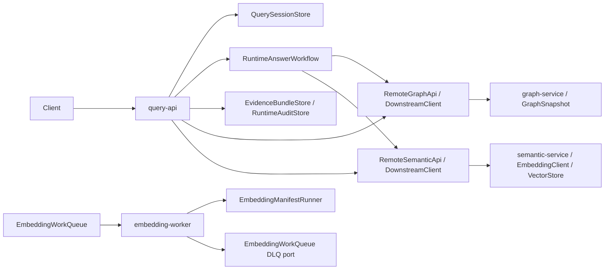

# ScholarChain REST services

Phase 10 provides four Java 17 / Scala 3.3.4 artifacts from one service distribution:
`QueryApiMain`, `GraphServiceMain`, `SemanticServiceMain`, and `EmbeddingWorkerMain` in
`edu.uic.cs441.scholarchain.services`. Cask 0.10.2 transports HTTP and delegates parsing,
authentication and dispatch to `ApiApplication`; application services call typed ports.
No route handler implements retrieval, metric computation, synthesis or verification.

The committed [OpenAPI contract](src/main/resources/openapi/scholarchain.v1.yaml) documents
public and internal routes. JSON in `src/main/resources/openapi/examples` is explicitly
synthetic format material, never a claim about a real researcher or deployed answer.

## Route and dependency graph

| Artifact | Routes and work |
| --- | --- |
| query-api | POST `/v1/query`; GET `/v1/jobs/{jobId}` and `/result`; GET `/v1/evidence/{evidenceId}`; GET `/v1/queries/{queryId}/evidence`; GET `/v1/explain/{queryId}`; graph proxy routes below |
| query-api, graph-service | GET `/v1/graph/nodes/{nodeId}` and `/neighbors` |
| graph-service | GET `/internal/v1/graph/nodes/{nodeId}` and `/neighbors`; GET `/internal/v1/graph/metrics/{nodeId}`; GET `/internal/v1/graph/paths` |
| semantic-service | POST `/internal/v1/semantic/retrieve` |
| query-api | POST `/internal/v1/semantic/retrieve` forwards to the configured semantic service |
| all artifacts | GET `/healthz`, `/readyz`, `/metrics` |
| embedding-worker | Bounded `EmbeddingWorkQueue` consumer, durable per-payload processing reservation, separate DLQ queue port |



`ExtendedApi` injects evidence, graph and semantic application services. `RemoteService` uses
Java HTTP clients wrapped by `DownstreamClient`; graph and semantic have separate circuit
breakers and registered metrics. Public graph ingress through query-api is a thin proxy to
internal graph endpoints. The explicit offline runtime also uses remote graph metrics and
semantic retrieval ports when both service URLs are configured. Runtime answers still pass
the real evidence builder, synthesis verifier and immutable audit store before publication.

## Execution modes and local run

All main classes require distinct `SCHOLARCHAIN_API_KEY_SHA256` and
`SCHOLARCHAIN_INTERNAL_TOKEN_SHA256`; there are no fallback credentials. Invalid/missing
configuration exits **2**, including malformed worker configuration before a listener starts.
Default `SCHOLARCHAIN_SERVICE_MODE=unconfigured` keeps liveness 200 and readiness 503 and
refuses query work. It never silently selects synthetic data as a production fallback.

Set `SCHOLARCHAIN_SERVICE_MODE=offline-synthetic` to explicitly run the declared Phase 9 G1
fixture. This mode creates only fake stores and a scripted model; no AWS SDK/provider client
or credentials are discovered. Its supported question is exactly:

```json
{"question":"Synthetic fixture: publication count for A","output":{"includeScores":false}}
```

A real `RuntimeAnswerWorkflow` retrieves fixture evidence, a scripted proposal copies its
publication-count value, `ClaimVerificationAgent` checks it, and the audit is persisted.
Other questions or mismatched structured constraints return typed 422 rather than invented
answers. All fixture identities and overlays are synthetic, as declared in `RuntimeOfflineFixture`.
The independently owned test fixture supplies separate hand-derived expected values.

Configure `SCHOLARCHAIN_GRAPH_BASE_URI` and `SCHOLARCHAIN_SEMANTIC_BASE_URI` together on
query-api to use independently running service artifacts. These HTTP(S) base URLs are runtime
inputs; URI user-info is forbidden. Supply `SCHOLARCHAIN_INTERNAL_TOKEN` through deployment
secret injection for outgoing calls and ensure its hash matches the internal-token hash.
The raw token is never logged, returned or committed. In that composition query execution
reads actual remote graph metric records and actual remote semantic hits, and graph exploration
is proxied to the graph artifact. Both dependency readiness checks must succeed for readiness
200. No request is sent to an AWS or paid model endpoint by these entrypoints.

Graph-service and semantic-service in offline mode use immutable fake graph/vector ports.
The semantic index starts empty and returns truthful empty hits; it never invents context.
Embedding-worker starts a bounded loop over an empty fake queue with a real
`ManifestEmbeddingProcessor`/`EmbeddingManifestRunner`; injection tests enqueue actual bounded
synthetic work. Live stores, SQS URLs, model clients and deployment lifecycle remain later
approved composition inputs. Offline mode is not a live production adapter configuration.

The distribution contains `services.jar`, `lib/`, and required `prompts/runtime` and
`prompts/schemas` assets. Build with `sbt packageServices` on JDK 17; Docker's `MAIN_CLASS`
build argument selects one of the four allowed mains. Container listeners require
`SCHOLARCHAIN_HTTP_HOST=0.0.0.0` explicitly. Images are built locally without a registry push.

## Requests, jobs and errors

`X-Request-Id` and `X-Trace-Id` are bounded safe correlation tokens, generated when absent or
invalid, returned on every application response and propagated to downstream calls. Query
constraints, analysis flags, retrieval caps and output options are validated. The runtime
adapter checks supplied filters/windows/caps against its actual plan before retrieval.
Evidence scores require an injected evidence store; they are observed retrieval signals,
not authoritative counts or invented fusion weights. Researcher rows use verified typed
claim subjects and values and stored candidate labels only; unavailable fields remain absent.
Numeric claim values remain decimal strings to preserve exact stored integers.

`Idempotency-Key` is required on query POSTs. An opaque deterministic query ID and hashed
application reservation isolate application sessions from audit/worker namespaces. Both
`Written(session)` and `Retried(_, Written(session))` enter the same body-binding path.
A revision-zero CAS binds a canonical JSON body fingerprint; only that winning binder schedules
work. Each binding attempt stores a fresh ownership token alongside its request/trace IDs,
which clients may reuse. If a binding write applies but its reply is lost (including a retried
conditional-conflict result), a primary read must match the exact intended revision and payload,
including fingerprint, request/trace IDs and ownership token, before this caller schedules it.
A competing binder can only replay that record or receive a body-conflict 409.

Other retried creation results also reconcile the authoritative primary record. Concurrent
callers wait for body binding within the configured downstream deadline; if the reservation is
still unbound, a replay may compete for the same revision-zero CAS. A clean bind rejection can
return a retryable 503 for that attempt, but leaves the key recoverable on a later request rather
than permanently stranded. Same-body replays of bound sessions return stored answers, terminal
errors or a current job reference; different bodies return 409 without running another workflow.

Synchronous wait and maximum workflow execution deadline are separate. Work exceeding only
the synchronous wait returns 202 and continues in the same bounded background worker task.
The reference reports the actual persisted QUEUED/RUNNING state. Job reads include state,
stage, timestamps, error and result URL. Workflow failures retry within the configured policy,
then persist a **nonretryable** terminal error; same-key replay cannot execute again. Queue-full
429 and oversize-result 502 are also terminal/nonretryable. A deliberate new workflow requires
a new idempotency key. Runtime-adapter failures do not retry an already published immutable audit.

| Status | Meaning |
| --- | --- |
| 400 | Malformed JSON, wrong types, invalid graph/cursor bounds, malformed query parameters |
| 401 | Missing or invalid authentication |
| 403 | Reserved for a configured permission policy; shared course key has one authorization domain |
| 404 | Missing job, evidence, audit or graph node |
| 409 | Different request body under an existing key or incompatible downstream state |
| 422 | Unsupported query/constraint, graph scan/node cap or incomplete bounded path expansion |
| 429 | Bounded local queue full or downstream throttling |
| 500 | Closed internal error with trace ID |
| 502 | Downstream failure, oversized result or rejected downstream authentication |
| 503 | Not ready, dependency unavailable or circuit open |
| 504 | Workflow/downstream/aggregate graph timeout |

Errors contain `error`, `message`, `traceId`, `retryable`. Logs and errors never contain provider
exception messages, stack traces, raw credentials, bodies, user queries or internal URLs.
Request logs use an allowlist of safe correlation IDs, route template, status and duration.
HTTP parser failures before Cask/application dispatch remain the server/parser boundary.

## Graph, evidence and audit semantics

`GraphSnapshot` explicitly promises immutable snapshot identity and directed edge records.
The in-memory implementation reads supplied edges and metrics without recomputation. The
older storage `GraphReader.neighbors` port does not expose direction or snapshot identity;
a live adapter must implement the stronger service port or reject unsupported directions.
No inferred directed edges are attributed to that older port.

Default graph exploration is `direction=both`, depth 1 (maximum 3), limit 50 (maximum 200),
edge types from `COAUTHORED_WITH,AUTHORED,HAS_TOPIC,AFFILIATED_WITH,PUBLISHED_IN`, and timeout
5000 ms. Complete expansion is bounded by edge/node scan caps and the aggregate requested
deadline, including blocking adapter calls. Stable BFS order determines pages. Signed opaque
cursors bind node, snapshot, direction, depth, edge filters, window, page limit and timeout.
Changing any binding or tampering rejects the cursor. Use a stable secret cursor key across
replicas; a per-process random key intentionally invalidates old cursors after restart.
Path results use shortest bounded BFS and never exceed the requested hop cap. Truncated
expansion yields 422 instead of a fabricated absence of paths.

Evidence reads retain the actual source dataset/record/snapshot/URI, work/chunk/path pointer,
score, compact stored content and full source provenance. Query evidence lists come from the
immutable audit. Explain reads persisted plan, versions, verification and stage failures;
`stagesExecuted` is only observed application-stage history, **null** if that application session
is unavailable. It never labels planned stages or prompt versions as executed stages. Retrieval
mode and filters live in the actual `queryPlan`; model versions include their prompt/schema
versions. `scoreComponents` shows actual persisted evidence scores without invented weights.
Latency/claim counters are actual audit observations; unmeasured retry/cache counts are null.
Hidden chain-of-thought, secret prompts and model-generated private reasoning are never returned.

## Worker safety and operational limits

`EmbeddingWorker.pollOnce` receives a configured batch, conditionally reserves a stable hash
of the full validated payload, then revision-CAS claims PROCESSING. Concurrent consumers
cannot both execute that reservation. Completed duplicates acknowledge without invoking the
processor. Failed attempts persist RETRY until the threshold (default 3). At the threshold the
worker first publishes to the injected DLQ queue, records DEAD, then acknowledges the original.
DLQ failure leaves the original unacknowledged and eligible for another delivery. Acknowledgement
failure also leaves the original; terminal replay safely acknowledges without another embedding.
The manifest processor retains the existing vector/text/model idempotency contracts.

This is at-least-once queue handling, not a distributed transaction. A crash after DLQ publication
but before marking DEAD can duplicate the DLQ entry. A crash while PROCESSING leaves a fenced
reservation needing explicit recovery; no lease is guessed or stolen. The existing queue port
decodes valid work payloads before returning them; malformed raw messages are rejected by that
adapter and need a deployment SQS redrive policy authored through Terraform. Live leases,
DLQ redrive and recovery are explicit later deployment gates.

GET/HEAD downstream reads retry only transient failures up to a finite attempt bound. Writes
and semantic POST calls attempt once. Each dependency owns its breaker: CLOSED failures open
it, reset permits one HALF_OPEN probe, success closes it and failed probes reopen it. Bounded
executor slots prevent unlimited blocked tasks; adapters must honor interrupts for prompt
cancellation. A graph-service operation exhausting its own execution budget returns the distinct
nonretryable `GRAPH_DEADLINE_EXCEEDED` 504. The proxy accepts this request-specific marker only
from a bounded, fully typed error body for an allowlisted internal graph GET operation. It uses
a fixed safe message and the caller's trace ID, attempts the request once, and leaves the graph
breaker healthy. Malformed/unrecognized markers, wrong operations, unready 5xx, connection
failures and transport timeouts without a response retain dependency retries and breaker failures.
`graph_request_deadlines_total` counts recognized request deadlines separately from dependency
errors/timeouts; HTTP 504/status/latency metrics still reflect the request outcome.

Query-api reserves response-delivery headroom for **every** internal graph GET operation:
node, neighbors, metrics and paths. Let `T` be the configured per-attempt transport timeout and
`P` the configured graph reserve percentage (default 25). The reserve is `ceil(T * P / 100)`
milliseconds, calculated without integer overflow. Before sending the request, query-api always
sets an explicit graph `timeoutMs` to `min(requested-or-configured-graph-cap, T - reserve)`.
With default 5000 ms transport and graph caps this forwards 3750 ms, leaving 1250 ms for delivery;
with equal 300 ms caps it forwards 225 ms. An explicitly requested 1 ms remains 1 ms.
Malformed, nonpositive or above-cap caller budgets return 400 before any backend call.
Graph-service consumes the forwarded budget on all four operations, including blocking node
and metric reads and path expansion. Actual transport failures remain dependency failures.

The clamp depends only on configuration and the caller's requested budget, not elapsed time or
connection state. Repeating the same cursor request under the same configuration therefore
preserves its signed budget binding. Changing the effective budget intentionally invalidates
old cursors. Reserve percentages must be 1–99 and graph caps positive; a graph client whose
transport/reserve combination leaves no positive work budget refuses configuration before a
listener starts. Two milliseconds with the default reserve permits one millisecond of work;
one millisecond cannot accommodate both work and response delivery. Semantic and readiness
requests retain their existing transport/dependency behavior. This repair does not change the
live snapshot-backend readiness contract (F16 remains future scope). Prometheus metrics cover HTTP requests/statuses, cumulative latency buckets,
API timeouts, per-attempt downstream errors/timeouts, registered breaker states and workflow
verification/abstention. Histogram boundaries 5 ms through 60 s/+Inf are fixed instrumentation
choices; p50/p95/p99 can be derived from the buckets.

## Configuration and verification

`ServiceConfig.fromEnvironment` externalizes application limits with prefix `SCHOLARCHAIN_`:

| Suffix | Default / rationale |
| --- | --- |
| API_KEY_SHA256, INTERNAL_TOKEN_SHA256 | Required distinct SHA-256 hashes; no default credentials |
| HTTP_HOST, HTTP_PORT | 127.0.0.1, 8080; explicit container bind |
| SYNCHRONOUS_DEADLINE_MS, WORKFLOW_TIMEOUT_MS | 15000, 60000; independent finite wait/execution bounds |
| MAX_WORKFLOW_RETRIES | 2; bounded job retries |
| WORKER_THREADS, QUEUE_CAPACITY | 4, 64; bounded execution and backlog |
| MAX_REQUEST_BYTES, MAX_RESULT_BYTES | 65536, 131072; bounded wire/result memory |
| MAX_QUESTION_CHARS | 8192 |
| MAX_GRAPH_LIMIT, MAX_VECTOR_LIMIT, MAX_PATH_DEPTH | 100, 50, 6; runtime query caps distinct from graph exploration caps |
| MAX_FILTER_ITEMS, MAX_FILTER_CHARS | 100, 512 |
| MAX_IDEMPOTENCY_KEY_CHARS | 256 before hashing |
| DOWNSTREAM_TIMEOUT_MS, DOWNSTREAM_MAX_ATTEMPTS | 5000, 3 per-read attempt |
| GRAPH_DEADLINE_RESERVE_PERCENT | 25; response headroom for graph requests, 1–99 |
| GRAPH_TIMEOUT_MS | 5000; positive declared graph work cap before proxy clamp |
| BREAKER_FAILURE_THRESHOLD, BREAKER_RESET_MS | 3, 30000 |
| SESSION_CAS_ATTEMPTS, SESSION_POLL_MS | 8, 50; tune poll interval upward for remote stores |
| REQUEST_READ_TIMEOUT_MS | 5000 socket inactivity bound, not an aggregate upload deadline |

Additional bootstrap graph prefix `SCHOLARCHAIN_GRAPH_`: `DIRECTION=both`,
`DEFAULT_DEPTH=1`, `MAX_DEPTH=3`, `DEFAULT_LIMIT=50`, `MAX_LIMIT=200`, `TIMEOUT_MS=5000`,
`DEFAULT_WINDOW=all-years`, `MAX_SCANNED_EDGES=10000`, `MAX_VISITED_NODES=2000`,
`MAX_CURSOR_CHARS=4096`, and `CURSOR_KEY` (random per-process unless injected).
Worker prefix `SCHOLARCHAIN_WORKER_`: `MAX_ATTEMPTS=3`, `BATCH_SIZE=1`, `POLL_MS=1000`.
Semantic injection config defaults top-K 50, question chars 8192, body bytes 65536,
filter count 16 and timeout 5000 ms. All caps are configured application bounds, not measured
production tuning. Publishing different public caps requires updating the deployment contract.

Prior observed targeted gates on Java 17: **26/26 module tests in four suites**; the combined
independent targeted-3 gate ran **36/36 tests in six suites** (20 from 10A, 16 from 10B).
After adding committed-example validation, the final independent 10B targeted gate ran
**17/17 tests in four suites**. The 37 independent 10A/10B tests ran together only within the
full check's 625 independent tests, rather than in a separate 37-test targeted gate. The wire
query-parameter, graph timeout, verified lifecycle, source-structure and worker cases passed.
Committed-example validation also passed. Final JDK 17.0.20.1 `sbt check` passed
**1199 tests in 145 suites, zero failures** (708 seconds reported by sbt). All **four Docker
images** rebuilt locally; **eight image smoke cases** and the **three-service HTTP composition**
passed. Exact commands, elapsed times, image IDs and retained logs are recorded by the
coordinator under `docs/agent-runs/phase-10`.

Repair round 1 (F6/F9) targeted validation passed **31/31 module tests in five suites** and
**41/41 independent 10A/10B tests in seven suites**, followed by successful `packageServices`.
The new cases distinguish graph request deadlines from real outages, preserve a healthy breaker
across repeated request deadlines, and retain retries/open circuits for malformed markers,
connection refusal, transport timeout without a response, and unready dependency responses.
The final repair JDK 17.0.20.1 `sbt check` passed **1208 tests in 147 suites, zero failures**
(709 seconds reported by sbt; 710.548 seconds wall time). All **four repaired Docker images**
rebuilt and passed **eight boot smoke cases** plus the **three-service remote HTTP composition**,
including real outage/readiness checks. The final retained check log and image/JAR hashes are
recorded by the coordinator in the repair evidence. The 1199-test result above is the historical
pre-repair 10B gate.

Repair round 2 (F6 default-budget residual) targeted validation passed **36/36 module tests in
six suites** and **44/44 independent 10A/10B tests in eight suites**, followed by successful
`packageServices`. Cases include real HTTP requests at equal graph/transport caps with omitted
or explicit full budgets, all-operation forwarding and enforcement, deterministic cursor replay,
nondefault environment settings, and impossible tiny configurations. The final repair-round-2
JDK 17.0.20.1 `sbt check` passed **1216 tests in 149 suites, zero failures** (721 seconds
reported by sbt; 723.581 seconds wall time). All **four round-2 Docker images** rebuilt and
passed **eight boot smoke cases** plus the **three-service remote HTTP composition** with equal
500 ms graph/transport caps and the stop-graph outage check. Exact commands, image/JAR hashes
and retained logs are recorded by the coordinator in the round-2 evidence. Earlier counts above
are historical checkpoints for their stated rounds.

No OpenSearch, optional index/service, CI workflow, cloud apply, live deployment or paid provider
call was added. Completed query results replay with the same injected persistent store, but the
local query executor is not a durable distributed dispatcher: process death can leave queued or
running jobs pending after a successful body binding. Transient lost replies on binding are
reconciled in the live process; a later same-key request can recover a reservation that remains
unbound after a bind rejection or a crash before binding. These recovery paths do not add a
background dispatcher for already-bound jobs after process death. A permanent store outage can
prevent reconciliation or terminal publication. These limitations,
remote polling tuning, live adapter configuration and deployment recovery must be resolved at
approved deployment gates; no live durability, cost or throughput claim follows from offline tests.
